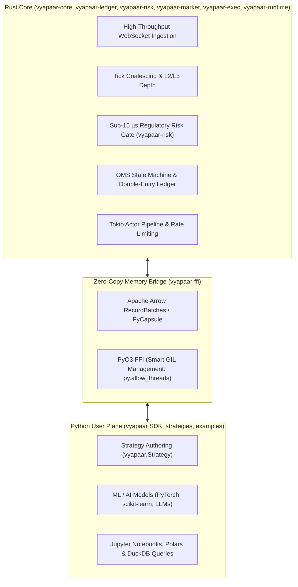

# Vyapaar Labs Ecosystem Instructions & Generic Agent Guidelines (`.agents/AGENTS.md`)

This is the canonical instruction file for AI coding agents, autonomous researchers, and software engineers working across the **Vyapaar Labs (व्यापार)** ecosystem. All autonomous agents (Claude, Gemini, Antigravity, OpenCode, Cursor, Codex) and subagents must strictly adhere to the architecture, coding standards, testing standards, and invariants defined in this document.

---

## 1. Generic Agent Architecture & Directory Specification (`.agents/`)

### 1.1 The Generic Agent Directory Standard
* **Universal Agent Home (`.agents/`)**:
  All autonomous tools, subagents, and development workflows must operate out of a standardized, vendor-neutral directory named `.agents/` located at the root of the workspace and at the root of each repository:
  ```text
  repo-root/
  ├── .agents/
  │   ├── AGENTS.md          <-- Repo-specific or workspace guidelines & invariants
  │   ├── HANDOFF.md         <-- Inter-agent state, batch progress, and pending tasks
  │   ├── settings.json      <-- Tool permissions and safety constraints
  │   ├── config/            <-- Agent and sandbox configuration files
  │   ├── skills/            <-- Extensible agent skill definitions
  │   └── rules/             <-- Granular prompt and linting rules
  ├── .claude -> .agents     <-- Compatibility symlink for vendor tooling
  ├── .gemini -> .agents     <-- Compatibility symlink for vendor tooling
  ├── src/                   <-- Production source code ONLY
  └── tests/                 <-- All tests parallel to src/
  ```
* **Elimination of Vendor-Specific Lock-In**:
  - Standalone `.claude`, `.gemini`, `.cursor`, or `.vscode` directories containing bespoke prompts or state are **strictly forbidden** from being duplicated.
  - Backward compatibility with legacy vendor tools is maintained exclusively via symbolic links (`.claude -> .agents`, `.gemini -> .agents`).
  - All agents read from and commit to `.agents/`.

### 1.2 Inter-Agent Handoff Protocol (`HANDOFF.md`)
* Every active engineering batch must maintain `.agents/HANDOFF.md`.
* When pausing or completing a turn, agents must record:
  1. **Phase / Slice Status**: What was designed, written, and verified.
  2. **Decisions & Discoveries**: Concrete probe-verified findings and wire contracts.
  3. **Immediate Next Step**: The exact next file, test, or slice to implement.
  4. **Operating Invariants**: Technical pins (e.g. pinned compiler/runtime versions, prohibited actions).
* Keeping `HANDOFF.md` current and short (not just appending to it) is itself binding — see §10
  and `.agents/rules/handoff-hygiene.md`.

---

## 2. Comprehensive Architectural Hints & Subsystem Map

### 2.1 Workspace Taxonomy (Bounded Contexts)
Vyapaar adopts a strict DDD bounded-context taxonomy, separating distinct bounded contexts into dedicated repositories:

| Subsystem | Directory | Language | Bounded Context & Responsibility |
| :--- | :--- | :--- | :--- |
| **Kernel** | `vyapaar-core/` | Rust | **Shared Kernel**: Canonical value objects (`Price`, `Quantity`, `Money`), wire contracts, OpenAPI 3.1 schemas, and `Decision` enum. |
| **Heart** | `vyapaar-ledger/` | Rust | **Domain Heart**: Order Management System (`oms`), FIFO tax-lot tracking (`portfolio`), and double-entry general ledger. |
| **Gate** | `vyapaar-risk/` | Rust | **Regulatory Risk Gate**: Sub-15 µs pre-trade risk engine (SEBI algo ID, OTR circuit breakers, price bands, freeze limits). |
| **Eye** | `vyapaar-market/` | Rust | **Market Data**: Multi-broker binary WebSockets (Kite, Upstox, Fyers, Angel One), tick coalescing, 100+ StockSharp indicators, Parquet Lakehouse. |
| **Hand** | `vyapaar-exec/` | Rust | **Execution**: Token-bucket rate limiter, freeze slicer, headless TOTP auth, Smart Order Router (SOR), SQLite WAL audit journal. |
| **House** | `vyapaar-runtime/` | Rust (Tokio) | **Central Actor Runtime**: Multi-threaded actor pipeline, Strategy Tester (`backtest`), and Automatic Strategy Enhancer (GA, Bayesian, WFO, DSR). |
| **Agent** | `vyapaar-agent/` | Rust + Python | **AI Agent**: Autonomous research loop, MCP server, prompt replayer, and StockSharp Odysseus genetic strategy synthesizer. |
| **Soul** | `vyapaar-ffi/`| Rust (PyO3) | **Python FFI Bridge**: Compiles `vyapaar` PyPI wheel, Arrow zero-copy memory bridge, and smart GIL management. |
| **Face** | `vyapaar-ui/` | Rust (Leptos) | **Web Dashboard (WASM)**: Strategy Studio visual node canvas, backtest simulator workbench, and openalgo-charts bridge. |
| **Strategies**| `vyapaar-strategies/`| Python | **Production Strategies**: Ported StockSharp strategies (Quoting, Arbitrage, TWAP/VWAP slicers, Turtle breakout, Risk Parity). |
| **Examples** | `vyapaar-examples/` | Python | **Learning Path**: Runnable Python reference scripts for Indian equities, options, factor models, and backtesting. |
| **Data** | `vyapaar-data/` | Python + DuckDB| **Data Lakehouse**: Point-in-time corporate actions, splits, dividends, coverage ledgers, and Parquet catalog. |
| **Docs** | `vyapaar-docs/` | Markdown | **Documentation**: Comprehensive architecture, API references, tutorials, and user guides built via MkDocs Material. |
| **Adapters** | `vyapaar-adapters/` | Python | **Broker Connectors**: Pluggable Python adapters for Dhan, Zerodha, Upstox, Angel One, Fyers, Kotak, IIFL. |

### 2.2 Event-Driven Architecture Pipeline
Vyapaar enforces a strict unidirectional event pipeline for all trading activity:


### 2.3 Zero-I/O Domain Purity & Temporal Determinism
* **Pure Domain Logic**:
  - The core domain crates (`vyapaar-core`, `vyapaar-ledger`, `vyapaar-risk`) must remain strictly zero-I/O:
    - No network sockets, no filesystem I/O (`std::fs`, `tokio::fs`), no database calls.
    - No direct clock queries: Never call `SystemTime::now()` or `Instant::now()` in domain state machines.
  - All state transitions receive an explicit `DateTime<Utc>`.
  - Replaying identical timestamped events must produce byte-for-byte identical state transitions in offline backtesting and live trading.
* **Zero Floats Policy**:
  - Floating-point types (`f32`, `f64`, or Python `float`) are **strictly prohibited** for prices, quantities, cash balances, statutory taxes, and margin calculations.
  - Rust: Always use exact 128-bit decimal arithmetic via `rust_decimal::Decimal`.
  - Python: Always use `decimal.Decimal`.
  - Strongly-typed domain primitives: `Price`, `Quantity`, and `Money`.

---

## 3. Coding Guidelines: Domain-Driven Design (DDD) & Test-Driven Development (TDD)

### 3.1 Domain-Driven Design (DDD) Invariants
* **Ubiquitous Language**:
  All agents, crates, and Python modules must use standardized domain terminology:
  - `InstrumentId`: Canonical scrip identifier (e.g. `NSE:RELIANCE-EQ`, `NFO:NIFTY24DEC24000CE`).
  - `Price`: Fixed-precision decimal value object representing per-unit price.
  - `Quantity`: Fixed-precision decimal representing order or position size.
  - `Money`: Fixed-precision decimal paired with explicit `Currency` (INR, USD).
  - `OrderSide`: Strictly `Buy` or `Sell`.
  - `OrderType`: `Limit`, `Market`, `StopLimit`, `StopMarket`.
  - `TimeInForce`: `Day`, `IOC` (Immediate or Cancel), `GTD` (Good Till Date).
  - `TaxLot`: Individual cost basis lot tracked via strict FIFO settlement accounting.
  - `FillReport`: Execution confirmation with explicit timestamp, executed price, quantity, exchange order ID, and transaction costs.
* **Bounded Context Boundaries & Anti-Corruption Layers (ACL)**:
  - Never leak broker-specific data structures into core domain engines.
  - Incoming raw WebSocket payloads from brokers (Kite, Upstox, Fyers) must be parsed inside `vyapaar-market` adapters and translated immediately to canonical `Tick` and `Bar` models.
* **Rich Domain Aggregates vs. Anemic Property Bags**:
  - Encapsulate business logic and validation rules inside Aggregate Roots and Entities (`OrderBook`, `Portfolio`, `RiskEngine`).
  - Never allow raw mutable property bags; all state transitions must be triggered via explicit, validated domain methods (`portfolio.apply_fill(&fill_report)?`).
* **Immutable Value Objects**:
  - Value Objects must be self-validating upon construction and compared purely by value.
  - Constructors must reject negative prices, negative lot sizes, or invalid currencies.

### 3.2 Test-Driven Development (TDD) & Parallel Test Directory Rule (MANDATORY)

#### Parallel Test Directory Structure
* **Tests MUST Live in `tests/` Parallel to `src/`**:
  All unit tests, integration tests, fuzzers, and property tests must reside in a dedicated `tests/` directory at the crate or package root:
  ```text
  my-crate/
  ├── Cargo.toml
  ├── src/                 <-- Production code ONLY
  │   ├── lib.rs
  │   ├── engine.rs
  │   └── order.rs
  └── tests/               <-- ALL unit & integration tests
      ├── unit_tests.rs
      ├── engine_tests.rs
      ├── order_tests.rs
      └── common/
  ```
* **STRICT BAN on In-File `#[test]` Blocks**:
  - **Strictly Forbidden**: Do NOT write `#[test]` functions or `#[cfg(test)] mod tests { ... }` blocks inside production source files (`src/*.rs` or `src/**/*.rs`).
  - Production source files must remain strictly focused on production business logic, domain invariants, and public interfaces.
  - Test scaffolding, mocks, fixtures, and assertions must be decoupled into the external `tests/` directory.
  - **Python Equivalent Rule**: In Python packages (`vyapaar-strategies`, `vyapaar-adapters`, `vyapaar-data`, `vyapaar-examples`), tests must reside in `tests/` (e.g. `tests/unit/`, `tests/integration/`), never inlined into library implementation files.

#### TDD Lifecycle (Red-Green-Refactor)
1. **Red**: Write a failing test in `tests/` specifying the expected behavior, domain contract, edge case, or regulatory constraint *before* implementing or modifying code in `src/`. Run the test suite and confirm failure.
2. **Green**: Write the minimal, cleanest production implementation in `src/` to satisfy the test.
3. **Refactor**: Clean up the implementation, optimize performance, eliminate duplication, and strengthen domain invariants while keeping the test suite green.

#### Property-Based & Golden Vector Testing
* Use property-based testing (`proptest` in Rust, `hypothesis` in Python) for mathematical transforms, price tick quantization, tax-lot accounting, and order state transitions.
* Maintain golden test vectors (`tests/golden/*.json`, `tests/golden/*.arrow`) to verify deterministic cross-language parity between Rust and Python engines.

---

## 4. Preference to Refactor, Interface-First, and Retargettable Design

### 4.1 Continuous Refactoring Culture
* **The Boy Scout Rule**: Always leave the codebase cleaner than you found it. When touching an existing module, clean up unused imports, dead code, stale comments, and obsolete workarounds.
* **Consolidation Over Duplication**: Never write duplicate logic across repositories. If a type or mathematical function is needed in multiple places, lift it into `vyapaar-core` or `vyapaar-ledger`.
* **Safe Refactoring Under Test Coverage**: Never attempt structural refactoring without existing comprehensive tests in `tests/`. If tests are missing, author tests first (Red), verify they pass against current behavior, and then refactor (Refactor).

### 4.2 Interface-First Design (Trait/Protocol Driven)
* **Define Abstractions First**:
  Always define traits (`trait` in Rust) or protocols/interfaces (`Protocol` / `ABC` in Python) before creating concrete implementations.
* **Program to Contracts, Not Concretions**:
  High-level trading components (strategies, risk checkers, portfolio managers) must depend exclusively on abstract interfaces:
  - `MarketDataFeed` (tick and bar streams)
  - `ExecutionGateway` (order submission, cancellation, modification)
  - `OrderManager` (order tracking and validation)
  - `IndicatorEngine` (feature generation and calculation)
* **Dependency Inversion & Swappability**:
  - Dependencies are injected via trait objects (`Arc<dyn Trait>`) or generic parameters (`T: Trait`).
  - Core domain engines must never couple to third-party SDKs, specific broker transports, or concrete storage layers.
  - Enables zero-friction mocking, deterministic test harness injection, and live-swapping between simulation and live broker execution.

### 4.3 Retargettable Design Invariants
Design every library and domain component to be easily retargettable across multiple execution environments:
1. **Platform Portability**:
   Native 64-bit support for `x86_64` and `aarch64` (Linux servers and Apple Silicon). Avoid architecture-specific assembly or platform-specific syscalls in core crates.
2. **WebAssembly (WASM) Targetable**:
   Compute crates (indicators in `vyapaar-market`, portfolio math in `vyapaar-ledger`, UI studio in `vyapaar-ui`) must compile cleanly to `wasm32-unknown-unknown`. Avoid blocking OS primitives, synchronous filesystem calls, or native thread spawns in portable crates.
3. **Dual Execution Target (Simulation vs. Live)**:
   Strategies, risk checks, and indicator pipelines must run byte-for-byte identical in offline historical backtesting (`vyapaar-runtime`) and live low-latency exchange execution (`vyapaar-exec`/`vyapaar-market`) by retargeting the underlying adapter trait.
4. **Broker / Exchange Agnostic**:
   Business logic is completely isolated from broker-specific quirks (Zerodha Kite, Upstox, Fyers, Angel One). Adapters normalize incoming ticks and outgoing orders to Vyapaar canonical domain contracts.

---

## 5. Idea Inheritance from Open-Source Quant Giants

Vyapaar deliberately adopts and synthesizes proven architectural patterns from the world's leading open-source trading and quantitative research frameworks:

### 5.1 Jesse: Pythonic Strategy Ergonomics & Metrics
* **Declarative Strategy Authoring**:
  Inspired by Jesse, Vyapaar strategy authors write intuitive, high-level Python code with direct primitives (`self.buy()`, `self.sell()`, `self.stop_loss`).
* **Hyperparameter Declarations & Routing**:
  Clear declarative parameters (`Parameter(min=..., max=..., step=...)`) and clean route definitions for multi-symbol, multi-timeframe strategies.
* **Crisp Validation Metrics**:
  Standardized statistical reporting: Sharpe Ratio, Sortino Ratio, Calmar Ratio, Expectancy, Win Rate, and Max Drawdown with clean visual summary generation.

### 5.2 QuantDinger & QuantConnect (Lean): Modular Algorithm Pipeline
* **Separation of Strategy Concerns**:
  Decomposition of complex trading systems into discrete models:
  - **Data Feed**: Streaming market ticks and historical bars.
  - **Alpha Model**: Generating directional predictions and trade signals.
  - **Portfolio Construction Model**: Sizing positions and allocating capital.
  - **Execution Model**: Splitting and routing orders into the market.
  - **Risk Management Model**: Continuous portfolio-level circuit breaking.
* **Unified Multi-Asset Time Series**: Seamlessly handling equities, index futures, and weekly options in a coherent event loop.

### 5.3 NautilusTrader: Ultra-Low Latency Rust Core & Exact Parity
* **Actor-Based Asynchronous Engine**: High-performance Rust core built on asynchronous message passing, lock-free queues, and Tokio actors.
* **Temporal Accuracy & Deterministic Clock**: Complete isolation from OS wall-clock time; simulated backtests step forward tick-by-tick with microsecond temporal accuracy.
* **Research-Live Parity**: The exact same strategy code executes in backtesting and live trading with zero modifications.
* **Double-Entry FIFO Ledger**: Multi-currency, tax-lot aware accounting guaranteeing ledger integrity down to the single paisa.

### 5.4 StockSharp: Comprehensive Indicator Library & Algorithmic Orders
* **100+ Indicators Library**: Extensive ported catalog of technical, statistical, and mathematical indicators in `vyapaar-market`, optimized for streaming tick updates.
* **Algorithmic Slicers & Order Types**: Pre-built execution algorithms including TWAP, VWAP, Pegged Orders, Icebergs, and Quoting/Arbitrage engines.

### 5.5 NoFX: AI-Native Runtime Safety & Guardrails
* **Untrusted AI Principle**: Large Language Models and AI agents are treated as untrusted signal generators. An AI model can never execute arbitrary commands or bypass risk limits.
* **Closed Decision Grammar**: AI decisions must strictly conform to `vyapaar_core::Decision` parsed via `#[serde(deny_unknown_fields)]`.
* **Deterministic Risk Gate Clamping**: A synchronous, non-bypassable pre-trade risk engine (`vyapaar-risk`) verifies and clamps every decision before it reaches execution buffers.
* **Cryptographic Replayability**: All prompts, completions, temperatures, and seeds are SHA-256 hashed and archived for deterministic replay in backtests.

---

## 6. Python-First SDK Architecture, Rust/Python Task Split & REST API

### 6.1 Python-First SDK Architecture
Strategies in Vyapaar are authored in pure, modern Python (3.11+) using the `vyapaar` PyPI wheel (compiled from `vyapaar-ffi` via PyO3):

```python
import vyapaar
from vyapaar import Strategy, Parameter, Bar, OrderEvent, Decimal

class NiftyMovingAverageCross(Strategy):
    fast_period = Parameter(default=10, min=5, max=50, step=5)
    slow_period = Parameter(default=30, min=20, max=100, step=10)

    def on_start(self) -> None:
        self.fast_ma = self.indicators.sma("NSE:NIFTY50-INDEX", self.fast_period)
        self.slow_ma = self.indicators.sma("NSE:NIFTY50-INDEX", self.slow_period)

    def on_bar(self, bar: Bar) -> None:
        if self.fast_ma.crosses_above(self.slow_ma):
            self.buy("NSE:NIFTY50-INDEX", quantity=Decimal("50"))
        elif self.fast_ma.crosses_below(self.slow_ma):
            self.sell("NSE:NIFTY50-INDEX", quantity=Decimal("50"))

    def on_order_event(self, event: OrderEvent) -> None:
        self.logger.info(f"Order event: {event.order_id} status={event.status}")
```

### 6.2 Task Split: Rust Core vs. Python Wrapper



* **Rust Core Responsibilities**:
  1. High-frequency I/O and binary WebSocket connections to broker gateways (`vyapaar-market`).
  2. Nanosecond-to-microsecond tick parsing, coalescing, and order book depth maintenance.
  3. Pre-trade regulatory risk gating (<15 µs in `vyapaar-risk`: SEBI algo ID, OTR counters, price bands, freeze limits).
  4. OMS state machine transitions, execution routing, rate limiting (`vyapaar-exec`).
  5. FIFO double-entry tax-lot accounting and ledger journaling (`vyapaar-ledger`).
  6. **GIL Independence**: Rust threads run freely without holding the Python GIL (`py.allow_threads`).
* **Python Wrapper Responsibilities**:
  1. User-facing strategy authoring and parameter definitions.
  2. AI/ML signal generation, factor modeling, and research workflows.
  3. Interactive exploration via Polars, Pandas, and Jupyter notebooks.
  4. GIL is acquired strictly when invoking strategy callbacks (`on_bar`, `on_tick`, `on_order_event`).
* **Zero-Copy Memory Exchange**:
  - Time series data, historical bars, and high-volume market snapshots are passed between Rust and Python using Apache Arrow RecordBatches and PyCapsule shared memory interfaces.
  - Zero heap allocation overhead on Python/Rust boundary.

### 6.3 Headless REST API & WebSocket Streaming Gateway
* **Axum-Powered Headless Server (`vyapaar-runtime-api-rest`)**:
  Vyapaar provides an industrial, headless HTTP/WebSocket API server exposing OpenAPI 3.1 endpoints generated directly from `vyapaar-core` types via `schemars`.
* **Canonical Endpoints**:
  - `GET  /health` & `GET /version`: System health, runtime diagnostics, and API version.
  - `POST /orders`: Place validated order (returns `client_order_id` and exchange tracking status).
  - `DELETE /orders/{id}`: Cancel open order.
  - `GET  /orders`: Query active and historical order logs.
  - `GET  /positions`: Fetch current real-time open positions.
  - `POST /positions/close`: Emergency close-all positions route.
  - `GET  /portfolio`: Query balance, equity, margin utilization, and FIFO trade history.
  - `GET  /risk`: Query live OTR counters, circuit breaker status, and algo-id states.
  - `POST /risk/kill-switch`: Instant platform-wide emergency trading halt.
  - `GET  /market-data/quote/{id}`: Latest quote and price band info.
  - `GET  /market-data/depth/{id}`: L2/L3 order book depth snapshot.
  - `POST /screener/scan`: Execute custom AST-filtered stock scans.
  - `WS   /ws/live`: Real-time bidirectional streaming WebSocket for order updates, fills, positions, and market depth.

---

## 7. GitHub Workflow Standards for All Repositories

Every repository in the Vyapaar workspace must adhere to a standardized GitHub CI/CD and pull-request workflow:

### 7.1 CI Pipeline Matrix by Repository Type
* **Rust Repositories** (`vyapaar-core`, `vyapaar-ledger`, `vyapaar-risk`, `vyapaar-market`, `vyapaar-exec`, `vyapaar-runtime`, `vyapaar-agent`, `vyapaar-ui`):
  - `.github/workflows/ci.yml`:
    1. Formatting: `cargo fmt --check`
    2. Linting: `cargo clippy --all-targets -- -D warnings`
    3. Tests: `cargo test --all --release`
* **Python Repositories** (`vyapaar-strategies`, `vyapaar-examples`, `vyapaar-adapters`, `vyapaar-data`):
  - `.github/workflows/ci.yml`:
    1. Linting & Formatting: `ruff check . && ruff format --check .`
    2. Type Checking: `pyright` (or `mypy`)
    3. Test Suite: `pytest -v`
* **Python FFI Bridge** (`vyapaar-ffi`):
  - Multi-platform test matrix (`linux-x86_64`, `linux-aarch64`):
    1. Maturin build: `maturin develop`
    2. Python test suite: `pytest -q`
  - `.github/workflows/ci.yml`:
    1. Type Check: `tsc --noEmit`
    2. Linting: `eslint .`
    3. Unit & Integration Tests: `vitest run`
    4. Production Build: `npm run build`
* **Documentation Repository** (`vyapaar-docs`):
  - `.github/workflows/ci.yml`:
    1. Build Validation: `mkdocs build --strict`

### 7.2 Pull Request & Branching Invariants
* **Trunk-Based / Feature Branching**: All work occurs in short-lived feature branches (`feat/...`, `fix/...`, `refactor/...`) and merges into `main` via PRs.
* **Pull Request Template (`.github/pull_request_template.md`)**:
  Every repo must provide a structured PR template confirming:
  - Description of changes and bounded context affected.
  - TDD verification: Link to newly added tests in `tests/`.
  - Zero-floats invariant confirmation (no `f32`/`f64` in financial paths).
  - Parallel test directory compliance check.
* **Semantic Commit Messages**:
  - `feat(<subsystem>): add SEBI OTR circuit breaker`
  - `fix(<subsystem>): correct tax-lot FIFO order allocation`
  - `test(<subsystem>): add proptest vectors for price quantization`
  - `refactor(<subsystem>): decouple ExecutionGateway into trait`

---

## 8. Subagent Discipline Rule (binding)

Every orchestrator session and spawned subagent obeys `.agents/rules/subagent-discipline.md`:
1. **Utmost 2 subagents alive at any point of time** (a wave of at most 2; verify; then the next wave).
2. **Zero recon for subagents**: every subagent prompt is self-contained (exact files, verified API signatures, designs, verify commands); subagents do not spend steps discovering the codebase — returning with a precise question is the correct failure mode.
3. **Zero-recon enforcement on the subagent side**: every spawned subagent must obey `.agents/rules/no-recon.md` — write-first (edits before any read), no orienting `ls`/`glob`/grep, no re-reading facts the prompt inlines, at most the 2 verification reads the prompt budgets; missing fact ⇒ stop and return one precise question.
4. Resumes go through `sessionID` with an "execute now" list; the orchestrator preserves verified facts and re-inlines them.

## 9. Gap Tracking Rule (binding)

Every orchestrator session and spawned subagent, in every repo in this workspace, obeys
`.agents/rules/gap-tracking.md`:
1. **File a gap, in the same change, whenever stubbing/mocking/hardcoding**: `docs/gaps/
   XXXX-short-slug.md` in the repo where the stub lives (status / what's stubbed / why / how to
   close it), plus a row in that repo's `docs/gaps/README.md`. Numbering is per-repo, sequential,
   never reused. A repo's `docs/gaps/` is created lazily on first use.
2. **Diagnose root cause, not just symptom, before filing** — in this multi-repo workspace the
   actual dependency a stub is waiting on often lives in a *different* `vyapaar-*` repo than the
   one the symptom shows up in (e.g. a build failure here caused by a missing feature flag in
   `vyapaar-core`). Name the real repo/path in the gap doc. File in the consuming repo; never
   silently patch a repo outside the current task's scope to close someone else's gap.
3. **Cite the dependency when implementing**: any change that depends on, works around, or is
   blocked by an existing gap (in this repo or another) names that gap's number in a code comment
   at the workaround and in the commit message — never build on top of a known gap uncited.
4. Reviewed the same way subagent discipline is: a non-trivial implementation's review pass greps
   the diff for stubs/mocks/hardcoded literals and confirms each has a gap doc (with a citation if
   it depends on an existing one). See `vyapaar-ui-web/docs/gaps/` for a reference implementation,
   including a cross-repo example (`0003-vyapaar-core-wasm32-uuid-getrandom.md`).

## 10. HANDOFF.md Hygiene Rule (binding)

Every orchestrator session and spawned subagent, in every repo in this workspace, obeys
`.agents/rules/handoff-hygiene.md`:
1. **Update `HANDOFF.md` in the same change** that changes what's true about Phase/Slice Status,
   Decisions & Discoveries, Immediate Next Step, or Operating Invariants (§1.2). Per-repo
   `HANDOFF.md` tracks that repo's own in-flight work; the `vyapaar-labs` root one tracks only
   what spans repo boundaries, and summarizes rather than duplicates a submodule's own file.
2. **Trim stale content in the same edit that makes it stale**, not as a separate periodic chore:
   a noted problem that's no longer true/reproducible, a gap that's since been implemented
   (closed gaps live in `docs/gaps/XXXX-*.md`, not `HANDOFF.md`), or a run/build/test report
   superseded by a newer one — all get removed, not left to accumulate.
3. **Growth itself is a signal**: if a reader can't scan it in under a minute, that's a trigger
   for a dedicated trim pass — fold completed, superseded slices into one line each (milestone +
   commit/PR pointer) rather than keeping every historical slice's full detail.
4. `HANDOFF.md` is forward-looking scratch memory for resuming paused work, not a permanent
   record — closed gaps, resolved bugs, and past run reports have permanent homes elsewhere
   (`docs/gaps/`, git history) and get cited from `HANDOFF.md`, not duplicated into it.
