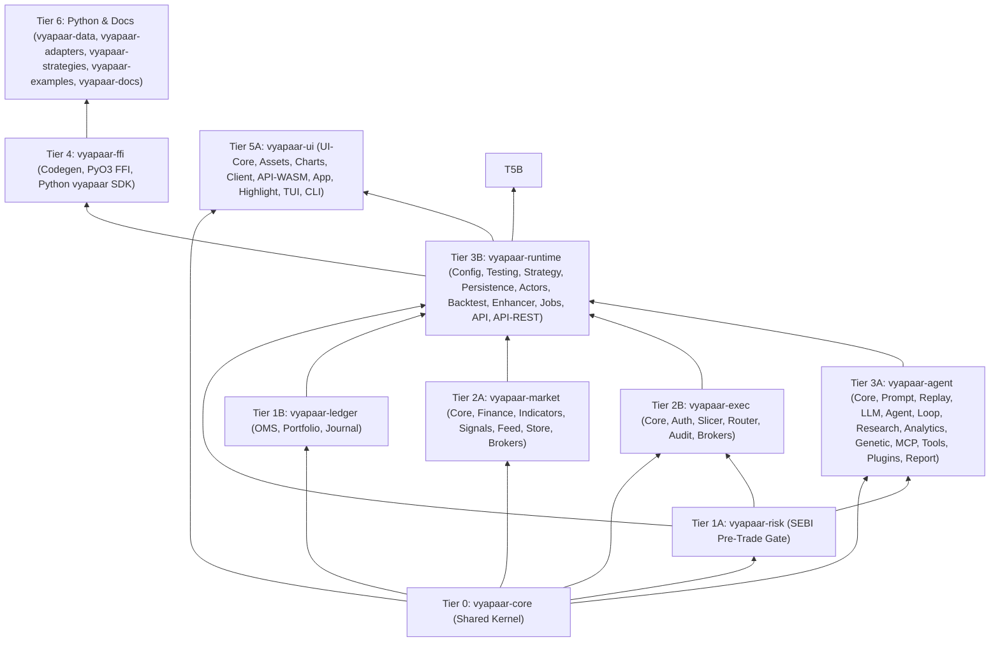

# Vyapaar Labs (`vyapaar-labs`) — Master Bottom-Up Migration & DDD Refactoring Guide

> **Canonical Orchestration Playbook for Autonomous Coding Agents**
> **Source Workspace**: `/home/pmallapp/Devel/Finance/honba-workspace` (`honba-*`)
> **Target Superproject**: `/home/pmallapp/Devel/Finance/vyapaar-labs` (`vyapaar-*`)
> **Strategy**: Strict **Bottom-Up Tiered Migration (Tier 0 → Tier 6)** with **In-Flight DDD Refactoring** and **Per-Tier TDD Verification Gates**.

---

## 1. Mission & Core Philosophy

`vyapaar-labs` is not a naive `sed s/honba/vyapaar/g` copy of `honba-workspace`. While `honba-workspace` contains battle-tested implementations across 15 repositories, our DDD architectural audit exposed several structural anti-patterns that **must be corrected during migration**:

1. **Overloaded Shared Kernel (`honba-core`)**: Contained UI/API read-models (`screener.rs`, `portfolio.rs`) and concrete sizing algorithms (`CanonicalPositionSizer`). In `vyapaar-core`, the Shared Kernel is slimmed to **pure Ubiquitous Language Value Objects, Aggregate IDs, Wire Contracts, Closed `Decision` Grammar, and `DomainEvent`s**.
2. **Anemic / Unvalidated Value Objects**: `Price(pub Decimal)` and `Quantity(pub Decimal)` exposed public tuple fields allowing negative values via deserialization. In `vyapaar-core`, value objects enforce construction invariants (`Price::try_new`, `Quantity::try_new`) and reject invalid states at the serde boundary.
3. **Split-Brain Ubiquitous Language in Domain Heart (`honba-kokoro` → `vyapaar-ledger`)**:
   - `honba-kokoro-oms` redefined its own `Exchange`, `Price`, `Quantity(u64)`, `OrderSide::{Long,Short}`, `async fn submit_order`, and `Utc::now()` calls.
   - `honba-kokoro-ledger` redefined its own `Exchange`, `TaxBreakdown`, and used dual string keys (`"Assets:Cash:BrokerAccount"` + `"CashAtBroker"`).
   - `honba-kokoro/src/repository.rs` embedded FIFO tax-lot matching business logic inside `InMemoryPositionRepository` instead of on the `Portfolio` Aggregate Root.
   - **Fix in `vyapaar-ledger`**: 100% unified on `vyapaar-core` types, strictly synchronous Zero-I/O (remove `tokio` from `vyapaar-ledger/Cargo.toml`), explicit `DateTime<Utc>` passed to all state transitions, and FIFO lot matching encapsulated on the `PortfolioAggregate`.
4. **Triple Duplication of Indian Statutory Costs & Calendars**:
   - Previously duplicated across `honba-kokoro-ledger`, `honba-me-market`, and `honba-ya-backtest`.
   - **Fix in `vyapaar-labs`**: `vyapaar-market-finance` (or `vyapaar-market-core`) owns the canonical Indian market microstructure pack (`IndiaMarketProfile`, `NseCalendar`, statutory STT/Stamp Duty/GST/SEBI/Exchange turnover schedules) implementing pure traits from `vyapaar-core`, and is injected into `vyapaar-ledger` and `vyapaar-runtime-backtest`.
5. **WASM vs. Native Runtime Pollution in `vyapaar-ui`**:
   - `vyapaar-ui` combines WASM crates (`vyapaar-ui-app`, `vyapaar-ui-api-wasm`, `vyapaar-ui-charts`) with native terminal crates (`vyapaar-cli`, `vyapaar-tui`, `vyapaar-highlight`).
   - **Fix in `vyapaar-ui`**: Strict target-agnostic purity in `vyapaar-ui-core` / `vyapaar-ui-client` / `vyapaar-ui-assets`, browser WASM dependencies isolated to `vyapaar-ui-{app,api-wasm,charts}`, and `tokio`/`ratatui` isolated to `vyapaar-{cli,tui}`.
6. **Strict Parallel Test Directory Rule**:
   - Upstream crates (`honba-kokoro-oms`, `honba-kokoro-ledger`, `honba-me-market`, `honba-ya-strategy`, `honba-ya-testing`) still had inline `#[cfg(test)] mod tests` inside `src/`.
   - **Fix in `vyapaar-labs`**: **ZERO** `#[test]` or `#[cfg(test)]` blocks inside `src/**/*.rs` across all crates. Every inline test module must be extracted into `<crate>/tests/` during migration.

---

## 2. Complete Subsystem Mapping Table (`honba` → `vyapaar`)

| Tier | `honba-workspace` Source | `vyapaar-labs` Target | Bounded Context | Sub-Crate / Package Renames & Additions |
| :---: | :--- | :--- | :--- | :--- |
| **0** | `honba-core/` | `vyapaar-core/` | **Shared Kernel** | Single crate `vyapaar-core`. Slimmed & hardened value objects. |
| **1A** | `honba-mon/` | `vyapaar-risk/` | **Pre-Trade Risk Gate** | Single crate `vyapaar-risk`. Sub-15 µs SEBI OTR, price bands, kill-switch. |
| **1B** | `honba-kokoro/` | `vyapaar-ledger/` | **Domain Heart (Zero-I/O)** | `honba-kokoro` → `vyapaar-ledger`<br>`honba-kokoro-oms` → `vyapaar-ledger-oms`<br>`honba-kokoro-portfolio` → `vyapaar-ledger-portfolio`<br>`honba-kokoro-ledger` → `vyapaar-ledger-journal` |
| **2A** | `honba-me/` | `vyapaar-market/` | **Market Data & Signals** | `honba-me-core` → `vyapaar-market-core`<br>`honba-me-market` → `vyapaar-market-finance`<br>`honba-me-feed` → `vyapaar-market-feed` + `vyapaar-market-store` **[SPLIT]**<br>`honba-me-normalizer` → `vyapaar-market-normalizer`<br>`honba-me-indicators` → `vyapaar-market-indicators`<br>`honba-me-signals` → `vyapaar-market-signals`<br>`honba-me-loaders` → `vyapaar-market-loaders`<br>`honba-me-{zerodha,upstox,fyers,angelone}` → `vyapaar-market-{zerodha,upstox,fyers,angelone}` |
| **2B** | `honba-te/` | `vyapaar-exec/` | **Execution Gateway** | `honba-te-core` → `vyapaar-exec-core`<br>`honba-te-auth` → `vyapaar-exec-auth`<br>`honba-te-router` → `vyapaar-exec-router`<br>`honba-te-slicer` → `vyapaar-exec-slicer`<br>`honba-te-audit` → `vyapaar-exec-audit`<br>`honba-te-{zerodha,upstox,angelone}` → `vyapaar-exec-{zerodha,upstox,angelone}` |
| **3A** | `honba-nou/` | `vyapaar-agent/` | **AI Agent & Agent Engine** | `honba-nou-core` → `vyapaar-agent-core`<br>`honba-nou-llm` → `vyapaar-agent-llm`<br>`honba-nou-agent` → `vyapaar-agent`<br>`honba-nou-prompt` → `vyapaar-agent-prompt`<br>`honba-nou-replay` → `vyapaar-agent-replay`<br>`honba-nou-trader-loop` → `vyapaar-agent-trader-loop`<br>`honba-nou-research` → `vyapaar-agent-research`<br>`honba-nou-analytics` → `vyapaar-agent-analytics`<br>`honba-nou-genetic-engine` → `vyapaar-agent-genetic`<br>`honba-nou-mcp` → `vyapaar-agent-mcp`<br>**[NEW]**: `vyapaar-agent-tools`, `vyapaar-agent-plugins`, `vyapaar-agent-report` |
| **3B** | `honba-ya/` | `vyapaar-runtime/` | **Central Actor Runtime** | `honba-ya-actors` → `vyapaar-runtime-actors`<br>`honba-ya-api` → `vyapaar-runtime-api`<br>`honba-ya-api-rest` → `vyapaar-runtime-api-rest`<br>`honba-ya-backtest` → `vyapaar-runtime-backtest`<br>`honba-ya-config` → `vyapaar-runtime-config`<br>`honba-ya-enhancer` → `vyapaar-runtime-enhancer`<br>`honba-ya-persistence` → `vyapaar-runtime-persistence`<br>`honba-ya-strategy` → `vyapaar-runtime-strategy`<br>`honba-ya-testing` → `vyapaar-runtime-testing`<br>**[NEW]**: `vyapaar-runtime-jobs` |
| **4** | `honba-tamashii/` | `vyapaar-ffi/` | **Python FFI Bridge** | `honba-tamashii-codegen` → `vyapaar-ffi-codegen`<br>`honba-tamashii-py` → `vyapaar-ffi-py`<br>`python/honba` → `python/vyapaar` (`vyapaar._vyapaar` ABI3 wheel) |
| **5A** | `honba-kao/` | `vyapaar-ui/` | **WASM Studio & TUI/CLI** | `honba-kao-app` → `vyapaar-ui-app`<br>`honba-kao-ui-core` → `vyapaar-ui-core`<br>`honba-kao-client` → `vyapaar-ui-client`<br>`honba-kao-api-wasm` → `vyapaar-ui-api-wasm`<br>`honba-kao-assets` → `vyapaar-ui-assets`<br>`openalgo-charts-rs` → `vyapaar-ui-charts`<br>**[NEW]**: `vyapaar-cli`, `vyapaar-tui`, `vyapaar-highlight` |
| **6A** | `honba-data/` | `vyapaar-data/` | **Data Lakehouse (Py)** | `src/honba_data` → `vyapaar_data` |
| **6B** | `honba-adapters/` | `vyapaar-adapters/` | **Python Broker SDK** | `src/honba_adapters` → `vyapaar_adapters` |
| **6C** | `honba-strategies/` | `vyapaar-strategies/` | **Strategy Catalog (Py)** | `src/honba_strategies` → `vyapaar_strategies` |
| **6D** | `honba-examples/` | `vyapaar-examples/` | **Reference Examples (Py)**| `src/honba_examples` → `vyapaar_examples` |
| **6E** | `honba-docs/` | `vyapaar-docs/` | **Documentation** | `mkdocs.yml` + `docs/` |

---

## 3. Bottom-Up Dependency DAG & Execution Order

Subagents **MUST** execute migration strictly in the following bottom-up order. Never start Tier $N$ until Tier $N-1$ passes `cargo fmt --check`, `cargo clippy --all-targets -- -D warnings`, and `cargo test --workspace`:



---

## 4. Step-by-Step Tiered Execution Protocol (With DDD Fixes)

### Pre-Flight Step (Workspace Hygiene)
Before running Tier 0:
1. Update `/home/pmallapp/Devel/Finance/vyapaar-labs/.agents/AGENTS.md` to reference `vyapaar-*` repositories and bounded contexts instead of `honba-*`.
2. Ensure every Rust repository (`vyapaar-core`, `vyapaar-risk`, `vyapaar-ledger`, `vyapaar-market`, `vyapaar-exec`, `vyapaar-runtime`, `vyapaar-agent`, `vyapaar-ffi`, `vyapaar-ui`) has a standardized repo-root `Makefile` supporting `prod`, `release`, `dev`, `check`, `test`, `fmt`, `clippy`, `clean`.

---

### Tier 0: `vyapaar-core` (Shared Kernel)
* **Detailed Playbook**: [`vyapaar-core/docs/migration-guide.md`](./vyapaar-core/docs/migration-guide.md)
* **Source**: `/home/pmallapp/Devel/Finance/honba-workspace/honba-core`
* **DDD Fixes to Apply During Migration**:
  1. **Promote Strongly-Typed Aggregate IDs into Kernel (`src/ids.rs`)**: Move `ClientOrderId`, `AlgoId`, `AccountId`, `TransactionId` from `honba-kokoro/crates/honba-kokoro/src/repository.rs` into `vyapaar-core` so all bounded contexts share identical strongly-typed IDs.
  2. **Self-Validating Value Objects (`src/types.rs`)**: Ensure `Price` and `Quantity` validate non-negative `Decimal` invariants on construction (`Price::try_new`, `Quantity::try_new`) and deserialization. Keep `Price::new` / `Quantity::new` panicking or `debug_assert!` on negative inputs, or provide validated serde visitors so negative prices/quantities can never enter the domain from JSON wire payloads.
  3. **Canonical `Exchange` & `ProductType` Unification**: Include `Exchange::{Nse, Bse, Nfo, Mcx, Cds}` and `ProductType::{Delivery, Intraday, Margin, CoverOrder, BracketOrder}` in `vyapaar-core` so downstream crates (`ledger`, `market`, `exec`) never redefine their own `Exchange` or `ProductType` enums.
  4. **Deterministic Constructors**: Remove `Uuid::new_v4()` from core domain constructors where deterministic replay is required, or provide explicit `OrderRequest::with_id(client_order_id, ...)` constructors alongside convenience helpers.
  5. **Extract Inline Tests**: Ensure all tests reside in `vyapaar-core/tests/` (`core_tests.rs`, `golden_test.rs`, `proptest_invariants.rs`, `schema_compatibility_test.rs`) and golden schemas live in `vyapaar-core/schema/`.
* **Verification Gate**:
  ```bash
  cd /home/pmallapp/Devel/Finance/vyapaar-labs/vyapaar-core
  cargo fmt --check && cargo clippy --all-targets -- -D warnings && cargo test
  ```

---

### Tier 1A: `vyapaar-risk` (Synchronous Pre-Trade Risk Gate)
* **Detailed Playbook**: [`vyapaar-risk/docs/migration-guide.md`](./vyapaar-risk/docs/migration-guide.md)
* **Source**: `/home/pmallapp/Devel/Finance/honba-workspace/honba-mon`
* **DDD Fixes to Apply During Migration**:
  1. Port `algo_registry.rs`, `engine.rs`, `error.rs`, `limits.rs`, `metrics.rs`, `otr.rs`, `refusal.rs`, `sizing_gate.rs`, `state.rs` from `honba-mon/src/` to `vyapaar-risk/src/`.
  2. Replace `honba_core` imports with `vyapaar_core`.
  3. Verify **Zero-I/O & Temporal Determinism**: Every `RiskEngine` check (`check_order`, `check_order_fast`, `record_fill`, `validate_sizing_request`) must take an explicit `now: DateTime<Utc>` parameter and never call `Utc::now()` or `Instant::now()`.
  4. Port all test suites from `honba-mon/tests/` into `vyapaar-risk/tests/` (zero `#[cfg(test)]` in `src/`).
* **Verification Gate**:
  ```bash
  cd /home/pmallapp/Devel/Finance/vyapaar-labs/vyapaar-risk
  cargo fmt --check && cargo clippy --all-targets -- -D warnings && cargo test
  ```

---

### Tier 1B: `vyapaar-ledger` (Pure Domain Heart: OMS, Portfolio, Double-Entry Journal)
* **Detailed Playbook**: [`vyapaar-ledger/docs/migration-guide.md`](./vyapaar-ledger/docs/migration-guide.md)
* **Source**: `/home/pmallapp/Devel/Finance/honba-workspace/honba-kokoro`
* **DDD Fixes to Apply During Migration**:
  1. **Enforce Zero-I/O Workspace Manifest**: Remove `tokio` from `vyapaar-ledger/Cargo.toml` `[workspace.dependencies]`. `vyapaar-ledger` must compile to `wasm32-unknown-unknown` and have zero async/network/disk dependencies.
  2. **Fix `vyapaar-ledger-oms` (`crates/vyapaar-ledger-oms`)**:
     - Delete the duplicate `Exchange`, `InstrumentId`, `OrderSide::{Long,Short}`, `OrderType`, `TimeInForce`, `Currency`, `Money`, `Quantity(u64)`, `Price` structs in `honba-kokoro-oms/src/lib.rs`. Use `vyapaar_core` types exclusively!
     - Delete `async fn submit_order`, `async fn cancel_order`, and `Utc::now()` calls.
     - Fix `OrderStateMachine`: Store `target_quantity: Quantity` and `filled_quantity: Quantity` per order so `process_fill(client_order_id, fill_qty, now)` transitions to `OrderState::PartiallyFilled` when `filled_quantity < target_quantity` and `OrderState::Filled` only when `filled_quantity >= target_quantity`.
     - Move the inline `#[cfg(test)] mod tests` (lines 570–765 of `honba-kokoro-oms/src/lib.rs`) to `crates/vyapaar-ledger-oms/tests/unit_tests.rs`.
  3. **Fix `vyapaar-ledger-portfolio` (`crates/vyapaar-ledger-portfolio`)**:
     - Unify `Fitolot`, `CostBasisLot`, and `TaxLot` into a single canonical `TaxLot` entity.
     - Encapsulate FIFO lot matching (`match_lots`) on the `Portfolio` / `AccountState` aggregate root rather than leaving it inside `InMemoryPositionRepository`.
     - Move `src/tests/mod.rs` out of `src/` into `crates/vyapaar-ledger-portfolio/tests/`.
  4. **Fix `vyapaar-ledger-journal` (`crates/vyapaar-ledger-journal`, ported from `honba-kokoro-ledger`)**:
     - Replace duplicate `Exchange` and string-typed account keys with strongly-typed `AccountCode` from `vyapaar-ledger` / `vyapaar-core`.
     - Move inline `#[cfg(test)] mod tests` (lines 612–864 of `honba-kokoro-ledger/src/lib.rs`) and `src/golden_tests/` into `crates/vyapaar-ledger-journal/tests/`.
* **Verification Gate**:
  ```bash
  cd /home/pmallapp/Devel/Finance/vyapaar-labs/vyapaar-ledger
  cargo fmt --check && cargo clippy --all-targets -- -D warnings && cargo test --workspace
  ```

---

### Tier 2A: `vyapaar-market` (Market Data, Microstructure Rules, Indicators, Signals & Store)
* **Detailed Playbook**: [`vyapaar-market/docs/migration-guide.md`](./vyapaar-market/docs/migration-guide.md)
* **Source**: `/home/pmallapp/Devel/Finance/honba-workspace/honba-me`
* **DDD Fixes to Apply During Migration**:
  1. **Clean Separation of `vyapaar-market-feed` vs `vyapaar-market-store`**:
     - In `honba-me`, `honba-me-feed` mixed live quote/tick streaming with Parquet Lakehouse storage (`lakehouse.rs`, `parquet_ticks.rs`, `recorder.rs`, `export/`, `import/`).
     - In `vyapaar-market`:
       - `vyapaar-market-feed` owns live stream traits, `CoalescingTickBuffer`, `ReconnectionManager`, and `live_quotes.rs`.
       - `vyapaar-market-store` owns Parquet Lakehouse storage (`lakehouse.rs`, `parquet_ticks.rs`, `recorder.rs`, `export/`, `import/`, `dataset.rs`).
  2. **Map `honba-me-market` → `vyapaar-market-finance`**:
     - `vyapaar-market-finance` houses `MarketProfile`, `MarketCalendar`, `CostSchedule`, `InstrumentRules`, `SettlementRules`, and the `india` market pack (`NseCalendar`, `CostModel`, `FnoContract`, `Nifty50`), plus macro/financial series models.
  3. **WASM Portability for Compute Crates**:
     - Keep `vyapaar-market-indicators`, `vyapaar-market-signals`, `vyapaar-market-normalizer`, and `vyapaar-market-finance` 100% free of `tokio` and OS filesystem I/O.
  4. **Extract All Inline `#[cfg(test)]` Blocks**:
     - Move `src/tests` from `honba-me-market`, `honba-me-indicators`, `honba-me-signals`, etc. into each crate's `tests/` directory.
* **Verification Gate**:
  ```bash
  cd /home/pmallapp/Devel/Finance/vyapaar-labs/vyapaar-market
  cargo fmt --check && cargo clippy --all-targets -- -D warnings && cargo test --workspace
  ```

---

### Tier 2B: `vyapaar-exec` (Execution Gateway, Auth, Router, Slicer, Audit & Broker Adapters)
* **Detailed Playbook**: [`vyapaar-exec/docs/migration-guide.md`](./vyapaar-exec/docs/migration-guide.md)
* **Source**: `/home/pmallapp/Devel/Finance/honba-workspace/honba-te`
* **DDD Fixes to Apply During Migration**:
  1. Port `honba-te-{core,auth,router,slicer,audit,zerodha,upstox,angelone}` into `vyapaar-exec-{core,auth,router,slicer,audit,zerodha,upstox,angelone}`.
  2. Enforce mandatory pre-trade risk evaluation in `vyapaar-exec-router` and `vyapaar-exec-core` via `vyapaar_risk::RiskEngine` before any order touches a `BrokerExecutor`.
  3. Ensure all broker wire serializers (`zerodha`, `upstox`, `angelone`) format `Price` and `Quantity` directly from `rust_decimal::Decimal` strings without intermediate `f64` casts.
  4. Extract any inline `src/` tests into `<crate>/tests/`.
* **Verification Gate**:
  ```bash
  cd /home/pmallapp/Devel/Finance/vyapaar-labs/vyapaar-exec
  cargo fmt --check && cargo clippy --all-targets -- -D warnings && cargo test --workspace
  ```

---

### Tier 3A: `vyapaar-agent` (AI Agent, LLM, Replay, Trader Loop, Genetic, MCP, Tools, Plugins, Report)
* **Detailed Playbook**: [`vyapaar-agent/docs/migration-guide.md`](./vyapaar-agent/docs/migration-guide.md)
* **Source**: `/home/pmallapp/Devel/Finance/honba-workspace/honba-nou`
* **DDD Fixes to Apply During Migration**:
  1. Port the 10 existing crates from `honba-nou/crates/honba-nou-*` to `vyapaar-agent/crates/vyapaar-agent-*` (`honba-nou-genetic-engine` → `vyapaar-agent-genetic`).
  2. Implement the 3 new bounded sub-crates cleanly:
     - `vyapaar-agent-tools`: Pure domain & agent tool registry (`AgentTool` trait, market/portfolio/screener query tools).
     - `vyapaar-agent-plugins`: Plugin manifest & capability loader (`PluginManifest`, sandboxed skill/tool discovery).
     - `vyapaar-agent-report`: Embedded Typst / Markdown tearsheet & research report compiler consuming `vyapaar-agent-analytics` and `vyapaar-agent-research`.
  3. Decouple `vyapaar-agent` from upward `vyapaar-runtime` dependencies: `vyapaar-agent-trader-loop` should depend on `vyapaar-core` ports and `vyapaar-risk`, not concrete `vyapaar-runtime` actors.
* **Verification Gate**:
  ```bash
  cd /home/pmallapp/Devel/Finance/vyapaar-labs/vyapaar-agent
  cargo fmt --check && cargo clippy --all-targets -- -D warnings && cargo test --workspace
  ```

---

### Tier 3B: `vyapaar-runtime` (Central Actor Runtime, Strategy, Backtester, Enhancer, Persistence, Jobs, REST API)
* **Detailed Playbook**: [`vyapaar-runtime/docs/migration-guide.md`](./vyapaar-runtime/docs/migration-guide.md)
* **Source**: `/home/pmallapp/Devel/Finance/honba-workspace/honba-ya`
* **DDD Fixes to Apply During Migration**:
  1. Port the 9 crates from `honba-ya/crates/honba-ya-*` to `vyapaar-runtime/crates/vyapaar-runtime-*` in internal topological order:
     `config` → `testing` → `strategy` → `persistence` → `backtest` → `enhancer` → `actors` → `jobs` → `api` → `api-rest`.
  2. Implement new crate `vyapaar-runtime-jobs`: Scheduled cron & background job runner (e.g., pre-market 08:45 IST TOTP auth refresh, bhavcopy ingestion, EOD T+1 settlement reconciliation, git2 config/state snapshots).
  3. **Move `src/tests/` out of `src/`**:
     - Both `honba-ya-strategy/src/tests/` and `honba-ya-testing/src/tests/` violate the Parallel Test Directory Rule (`AGENTS.md` §3.2). Relocate them into `crates/vyapaar-runtime-strategy/tests/` and `crates/vyapaar-runtime-testing/tests/`.
* **Verification Gate**:
  ```bash
  cd /home/pmallapp/Devel/Finance/vyapaar-labs/vyapaar-runtime
  cargo fmt --check && cargo clippy --all-targets -- -D warnings && cargo test --workspace
  ```

---

### Tier 4: `vyapaar-ffi` (PyO3 Native FFI Bridge & `vyapaar` Python SDK)
* **Detailed Playbook**: [`vyapaar-ffi/docs/migration-guide.md`](./vyapaar-ffi/docs/migration-guide.md)
* **Source**: `/home/pmallapp/Devel/Finance/honba-workspace/honba-tamashii`
* **DDD Fixes to Apply During Migration**:
  1. Port `honba-tamashii-codegen` → `vyapaar-ffi-codegen` and `honba-tamashii-py` → `vyapaar-ffi-py`.
  2. Port `python/honba/` → `python/vyapaar/` and root `pyproject.toml` (building the `vyapaar` wheel with native module `vyapaar._vyapaar`).
  3. Ensure every Python-submitted order passes through `vyapaar_risk::RiskEngine` and releases the Python GIL (`py.allow_threads`) during Rust actor/backtest execution.
* **Verification Gate**:
  ```bash
  cd /home/pmallapp/Devel/Finance/vyapaar-labs/vyapaar-ffi
  cargo fmt --check && cargo clippy --all-targets -- -D warnings && cargo test --workspace
  ```

---

### Tier 5A & 5B: Workstations (`vyapaar-ui` ) — ✅ **COMPLETE (2026-11-05)**
* **Detailed Playbooks**:
  - [`vyapaar-ui/docs/migration-guide.md`](./vyapaar-ui/docs/migration-guide.md) (Source: `honba-workspace/honba-kao`)
* **DDD Fixes to Apply During Migration**:
  1. In `vyapaar-ui`: Remove unconditional `tokio` dependencies from WASM crates (`vyapaar-ui-core`, `vyapaar-ui-assets`, `vyapaar-ui-charts`, `vyapaar-ui-client`, `vyapaar-ui-api-wasm`, `vyapaar-ui-app`).
  2. Implement `vyapaar-highlight` (tree-sitter syntax highlighter), `vyapaar-tui` (Ratatui terminal workstation), and `vyapaar-cli` (`vyapaar` static binary with `vyapaar tui`, `vyapaar ask`, `vyapaar backtest`, `vyapaar serve` subcommands).
  3. Do **NOT** copy `honba-kao/crates-old/` dead legacy code.
* **Verification Gate** (all green):
  ```bash
  cd /home/pmallapp/Devel/Finance/vyapaar-labs/vyapaar-ui
  cargo fmt --check && cargo clippy --all-targets -- -D warnings && cargo test --workspace
  cargo check -p vyapaar-ui-app --target wasm32-unknown-unknown
  ```
* **Migration notes**: honba-kao source was unavailable in the environment;
  all 9 crates implemented fresh against the sub-guide contracts. See
  `vyapaar-ui/docs/migration-guide.md` §4 and `vyapaar-ui/.agents/HANDOFF.md`.

---

### Tier 6: Python Ecosystem & Documentation (`vyapaar-data`, `vyapaar-adapters`, `vyapaar-strategies`, `vyapaar-examples`, `vyapaar-docs`) — ✅ **COMPLETE (2026-11-06)**
* **Detailed Playbooks**:
  - [`vyapaar-data/docs/migration-guide.md`](./vyapaar-data/docs/migration-guide.md)
  - [`vyapaar-adapters/docs/migration-guide.md`](./vyapaar-adapters/docs/migration-guide.md)
  - [`vyapaar-strategies/docs/migration-guide.md`](./vyapaar-strategies/docs/migration-guide.md)
  - [`vyapaar-examples/docs/migration-guide.md`](./vyapaar-examples/docs/migration-guide.md)
  - [`vyapaar-docs/docs/migration-guide.md`](./vyapaar-docs/docs/migration-guide.md)
* **DDD Fixes to Apply During Migration**:
  1. Fix all `pyproject.toml` files in `vyapaar-{data,adapters,strategies,examples}`: remove invalid `"rust_decimal>=1.0.0"` dependency and declare proper PEP 621 dependencies (`vyapaar`, `polars`, `pyarrow`, `duckdb`, `pydantic`).
  2. Enforce the 4-Zone Clean Package Layout (`src/vyapaar_<pkg>/` or `vyapaar_<pkg>/`, `tests/`, `configs/` or `catalog/`, `docs/`).
* **Verification Gates** (all green, verified 2026-11-06):
  ```bash
  for r in vyapaar-data vyapaar-adapters vyapaar-strategies vyapaar-examples; do
    (cd $r && pytest -q && ruff check . && ruff format --check .)
  done
  (cd vyapaar-docs && mkdocs build --strict)
  ```
* **Migration notes**: `honba-{data,adapters,strategies,examples,docs}` sources
  were unavailable in the environment; all five repositories were implemented
  fresh against the sub-guide contracts (see each repo's `.agents/HANDOFF.md`).
  Zero-floats invariants and the parallel test directory rule are enforced by
  ruff (`RUF032` rejects `Decimal(<float literal>)`) and `mypy` in CI.

---

## 5. Subagent Delegation Matrix

You can delegate individual tiers or repositories in parallel within the same tier using `invoke_subagent`:

| Batch | Parallelizable Subagent Tasks | Prerequisite |
| :--- | :--- | :--- |
| **Batch 1** | Agent A: `vyapaar-core` (Tier 0) | None |
| **Batch 2** | Agent A: `vyapaar-risk` (Tier 1A)<br>Agent B: `vyapaar-ledger` (Tier 1B) | Batch 1 Green |
| **Batch 3** | Agent A: `vyapaar-market` (Tier 2A)<br>Agent B: `vyapaar-exec` (Tier 2B)<br>Agent C: `vyapaar-agent` (Tier 3A) | Batch 2 Green |
| **Batch 4** | Agent A: `vyapaar-runtime` (Tier 3B)<br>Agent B: `vyapaar-ui` (Tier 5A) | Batch 3 Green |
| **Batch 5** | Agent A: `vyapaar-ffi` (Tier 4) | Batch 4 Green |
| **Batch 6** | Agent A: `vyapaar-data` & `vyapaar-adapters`<br>Agent B: `vyapaar-strategies` & `vyapaar-examples`<br>Agent C: `vyapaar-docs` | Batch 5 Green |
