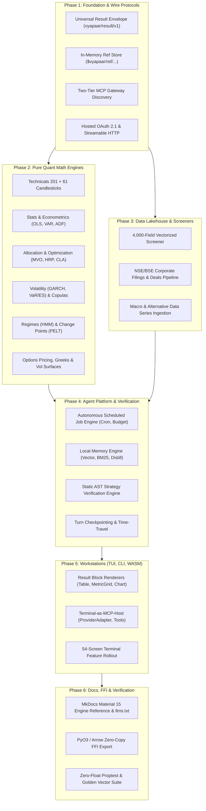

# 0001 — Fincept & Quantcepts Feature Parity, Gap Closure, and Platform Expansion Master Plan

> **Status**: Approved Architecture & Implementation Roadmap  
> **Target Scope**: Platform-wide across `vyapaar-core`, `vyapaar-risk`, `vyapaar-ledger`, `vyapaar-market`, `vyapaar-exec`, `vyapaar-agent`, `vyapaar-runtime`, `vyapaar-data`, `vyapaar-ffi`, `vyapaar-ui`, `vyapaar-docs`  
> **Reference Inputs**:  
> - `docs/tmp/fincept-quantcepts-mapping.md` (Draft concept mapping & inventory)  
> - `docs/design/architecture.md` & `AGENTS.md` (Strategic & Tactical DDD invariants)  
> - `docs/roadmap/roadmap.md` (Platform milestone sequencing)  
> - `vyapaar-agent/docs/plans/0001-mcp-gateway-discovery-and-quantitative-engines.md`  
> - `vyapaar-agent/docs/plans/0002-autonomous-jobs-memory-and-strategy-verification-engine.md`  
> - `vyapaar-data/docs/plans/0001-mcp-market-and-screener-data-feed-ports.md`  
> - `vyapaar-ui/docs/plans/0001` through `0004` (Chat terminal, UX reference, result blocks, CLI/TUI)  
> - `vyapaar-docs/docs/plans/0001-mcp-gateway-and-quantitative-toolset-reference.md`  

---

## 0. Executive Summary & Vision

Fincept (18 stateful toolsets, 443 tools, 17 stateless analytics engines, Qt desktop terminal) and Quantcept (AI research desk for financial markets) demonstrate how an institutional quantitative trading workbench and AI-first agent ecosystem operate in practice.

A cross-repo architectural gap analysis against `vyapaar-labs` reveals two fundamental truths:
1. **Vyapaar's Domain Core is Architecturally Superior**: Vyapaar’s zero-I/O domain purity, sub-15 µs SEBI pre-trade risk gate (`vyapaar-risk`), aggregate-owned FIFO tax-lot accounting (`vyapaar-ledger`), research-live backtest parity, and strict zero-floats invariant (`rust_decimal::Decimal` everywhere) provide an institutional foundation that Fincept lacks (Fincept has no documented decimal policy and relies on untyped pub/sub).
2. **Vyapaar Has Honest Breadth Gaps**: Fincept provides broader surface area in technical indicators (201 vs 17), screening breadth (4,000 fields & global scope vs India-only), missing advanced quantitative engine families (GARCH volatility, regime detection, copulas, structural change points, portfolio allocation optimization, derivatives/options pricing & Greeks, general statistical forecasting), agent platform conventions (two-tier MCP discovery, universal result envelopes, in-memory `$ref` data chaining, large-result paging), and workstation UI screens (54 desktop screens across multiple financial subdomains).

This master plan establishes the end-to-end blueprint to **achieve 100% parity and supersede every gap and feature** identified in `docs/tmp/fincept-quantcepts-mapping.md`, while uncompromisingly enforcing Vyapaar's core architectural tenets:
- **Zero Floats Rule**: All monetary, price, quantity, margin, fee, and risk values use `rust_decimal::Decimal` (Rust) and `decimal.Decimal` (Python). No floating-point contamination.
- **Zero-I/O Domain Purity**: Domain logic and analytical compute engines are pure, deterministic, and free from wall-clock, network, database, or disk dependencies.
- **NoFX Untrusted AI Principle**: All AI and LLM outputs are strictly advisory; automated trade actions generate proposed signals that must be deterministically vetted by `vyapaar-risk`.
- **In-Process High Performance**: Compute engines execute in native Rust (with PyO3/Arrow zero-copy bridge via `vyapaar-ffi`), avoiding subprocess JSON cold-start latency.

---

## 1. System Architecture Topology

The target platform integrates the 18 stateful toolsets, 17 analytical engines, MCP infrastructure, and 54-screen UI across Vyapaar's 6 architectural layers:

```
┌────────────────────────────────────────────────────────────────────────────────────────────────────────┐
│                                   LAYER 5: WORKSTATIONS (vyapaar-ui)                                    │
│  ┌───────────────────────────────┐ ┌───────────────────────────────┐ ┌───────────────────────────────┐ │
│  │ Leptos 0.8 WASM Studio        │ │ Ratatui TUI Terminal          │ │ Native CLI (vyapaar-cli)      │ │
│  │ 54 Screens (Markets, Trading, │ │ Full-screen TUI with          │ │ Direct commands, tool search, │ │
│  │ Portfolio, News, Workbench)   │ │ AgentChat, Sparklines, Tables │ │ Ask, Jobs, Doctor, MCP config │ │
│  └───────────────┬───────────────┘ └───────────────┬───────────────┘ └───────────────┬───────────────┘ │
└──────────────────┼─────────────────────────────────┼─────────────────────────────────┼─────────────────┘
                   │                                 │                                 │
┌──────────────────▼─────────────────────────────────▼─────────────────────────────────▼─────────────────┐
│                               LAYER 3: AI AGENTS & ACTOR RUNTIME                                        │
│  ┌───────────────────────────────────────────────────────────────────────────────────────────────────┐  │
│  │ vyapaar-agent-mcp: Hosted OAuth 2.1 & Local Stdio/SSE Server                                      │  │
│  │  • Two-Tier Discovery Gateway: vyapaar_search_tools, vyapaar_describe_tool, vyapaar_call_tool      │  │
│  │  • Paged Result Reader: vyapaar_read_result (>40KB tickets)                                       │  │
│  │  • Universal Result Envelope (vyapaar/result/v1) with DisplayBlocks (Table, MetricGrid, Chart)    │  │
│  │  • Tool Annotations: readOnlyHint, destructiveHint, idempotentHint                                │  │
│  ├───────────────────────────────────────────────────┬───────────────────────────────────────────────┤  │
│  │ vyapaar-agent (AI Core & Loop)                    │ vyapaar-runtime (Central Execution & Actors)  │  │
│  │  • Autonomous Job Scheduler (Cron, Budgets)       │  • Supervised Actor Pipeline (Market->Ledger) │  │
│  │  • Persistent Financial Memory & Distillation     │  • Backtest Engine & Walk-Forward Optimizer   │  │
│  │  • Static Strategy Verification (Lookahead/Leak)  │  • Paper Trading Engine & Live/Paper Parity   │  │
│  │  • Odysseus Genetic Strategy Synthesizer          │  • Multi-Period Execution Simulator           │  │
│  └───────────────────────────────────────────────────┴───────────────────────────────────────────────┘  │
└──────────────────────────────────────────────────┬──────────────────────────────────────────────────────┘
                                                   │
┌──────────────────────────────────────────────────▼──────────────────────────────────────────────────────┐
│                   LAYER 2 & LAYER 1: QUANT ENGINES, MARKET EYE, RISK & LEDGER                           │
│  ┌───────────────────────────────────────┐  ┌────────────────────────────────────────────────────────┐  │
│  │ vyapaar-market & Analytical Engines   │  │ vyapaar-risk & vyapaar-ledger (Domain Heart)           │  │
│  │  • 201 Technicals + 61 Candlestick    │  │  • SEBI Pre-Trade Gate (<15 µs p99.99, OTR, Bans)      │  │
│  │  • Options Pricing & Vol Surfaces     │  │  • Rich OMS State Machine & Order Book Aggregates      │  │
│  │  • GARCH Volatility & VaR/ES Engine   │  │  • FIFO Tax-Lot Portfolio & Capital Gains (STCG/LTCG)  │  │
│  │  • Allocation & Optimizer (HRP, MVO)  │  │  • Double-Entry Balance Sheet Journal                  │  │
│  │  • Stats, Copulas, Regimes, Breaks    │  │  • Indian Statutory Cost Engine (STT, GST, Stamp, SEBI)│  │
│  └───────────────────────────────────────┘  └────────────────────────────────────────────────────────┘  │
└──────────────────────────────────────────────────┬──────────────────────────────────────────────────────┘
                                                   │
┌──────────────────────────────────────────────────▼──────────────────────────────────────────────────────┐
│                               LAYER 0, 4, 6: DATA LAKEHOUSE & SHARED KERNEL                             │
│  ┌─────────────────────────────────────┐  ┌─────────────────────────────────────────────────────────┐  │
│  │ vyapaar-core (Shared Kernel L0)     │  │ vyapaar-data & vyapaar-ffi (Data Lakehouse & Bridge)    │  │
│  │  • Canonical Decimal Value Objects  │  │  • In-Memory Ephemeral Store ($vyapaar/ref/<uuid>)      │  │
│  │  • vyapaar/result/v1 Wire Envelopes │  │  • 4,000-Field Vectorized Screener Engine (Arrow)       │  │
│  │  • Universal Domain Events & Ports  │  │  • Filings Ingestion (BSE/NSE/SEBI), Macro, Corporate   │  │
│  │  • Table-Driven Broker Wire Mappings│  │  • PyO3 / Arrow Zero-Copy Extension (vyapaar wheel)     │  │
│  └─────────────────────────────────────┘  └─────────────────────────────────────────────────────────┘  │
└────────────────────────────────────────────────────────────────────────────────────────────────────────┘
```

---

## 2. Platform & MCP Infrastructure Gap Closure

### 2.1 Hosted Multi-Tenant MCP Server & Streamable HTTP
- **Current State**: `vyapaar-agent-mcp` is scoped primarily to local stdio / loopback.
- **Target Implementation**:
  - Implement dual transports in `vyapaar-agent-mcp`:
    1. `StdioTransport`: Fast zero-overhead pipe for local CLI (`vyapaar-cli mcp`) and desktop workstations.
    2. `HttpStreamTransport`: Production HTTP server implementing MCP Streamable HTTP (Server-Sent Events for streaming responses, HTTP POST for tool invocations).
  - Add OAuth 2.1 authorization with PKCE and scoped bearer tokens (`Bearer vyp_...`), multi-tenant account isolation, and tenant-level quota/rate limiting.
  - Expose health check, schema reflection, and protocol handshake endpoints conforming to the latest MCP specification.

### 2.2 Terminal-as-MCP-Host in `vyapaar-ui`
- **Current State**: Terminal only operates as a consumer; LLM tool dispatching is not integrated into desktop/TUI client.
- **Target Implementation**:
  - Embed `McpHostManager` inside `vyapaar-ui-core`:
    - `ProviderAdapter` trait with pluggable implementations: Anthropic (Claude 3.5 Sonnet / 3.7 Opus), OpenAI (GPT-4o, o3-mini), Google Gemini (Gemini 2.0 Flash / Pro), and Local Models (Ollama / vLLM / llama.cpp).
    - `ToolDispatcher`: Dispatches tool requests to both local embedded tools (workspace, screen navigation, chart rendering, local note-taking) and remote/in-process MCP servers.
    - Expose ~40 internal workstation tools enabling the conversational agent to manipulate the UI (e.g., `ui_open_chart`, `ui_set_watchlist`, `ui_render_backtest_report`, `ui_create_alert`).

### 2.3 Two-Tier Tool Discovery Gateway
- **Current State**: Flat tool registration prone to LLM context bloat when scaling beyond 40 tools.
- **Target Implementation**:
  - Implement two-tier discovery in `vyapaar-agent-mcp`:
    - **Tier 1 (Eager Core Tools)**: Advertised on startup:
      - `vyapaar_search_tools(query, category)`: Semantic & keyword search across tool names, descriptions, and tags.
      - `vyapaar_describe_tool(tool_name)`: Returns complete JSON schema, parameter bounds, zero-float validation rules, and examples.
      - `vyapaar_call_tool(tool_name, arguments)`: Dynamic dispatch wrapper.
      - `vyapaar_read_result(ref_id, offset, limit)`: Large-payload pagination.
    - **Tier 2 (Categorized Catalogs)**: 15 domain toolsets partitioned into namespaces (`market`, `technicals`, `scanner`, `analytics`, `validation`, `allocation`, `risk`, `regimes`, `change_points`, `volatility`, `copula`, `pricing`, `ledger`, `research`, `backtest`).

### 2.4 Universal Result Envelope (`vyapaar/result/v1`)
- **Current State**: Endpoint-specific DTOs without a unified cross-platform representation.
- **Target Implementation**:
  - Define `VyapaarResultEnvelope<T>` in `vyapaar-core::result` as the canonical wire contract:
    ```rust
    #[derive(Debug, Clone, Serialize, Deserialize)]
    pub struct VyapaarResultEnvelope<T> {
        pub schema: String,                    // "vyapaar/result/v1"
        pub status: ResultStatus,              // Ok | Warning | Error
        pub meta: ExecutionMeta,               // elapsed_ms, timestamp_ist, engine_version, precision
        pub summary: String,                   // 1-line plain language summary for the agent
        pub data: T,                           // Strongly-typed domain payload
        pub blocks: Vec<DisplayBlock>,         // Visual blocks: Table, MetricGrid, Chart, Alert
        pub refs: HashMap<String, String>,     // Ephemeral data handles ($vyapaar/ref/...)
        pub warnings: Vec<String>,             // Non-fatal advisory notes
        pub error: Option<ResultError>,        // Structured code & actionable remediation hint
    }
    ```
  - Standardize `DisplayBlock` rendering across `vyapaar-cli` (colored UTF-8 ANSI), `vyapaar-tui` (interactive Ratatui widgets), and `vyapaar-ui-app` (Leptos reactive DOM components).

### 2.5 In-Memory Ephemeral Data References (`$vyapaar/ref/...`)
- **Current State**: Large payloads round-trip through LLM context or require ad-hoc files.
- **Target Implementation**:
  - Build `DataReferenceStore` in `vyapaar-agent-core` backed by memory-mapped Apache Arrow record batches and DuckDB in-memory tables.
  - Large time-series (e.g. 10,000 1-minute bars or 4,000 screener rows) are assigned a URI handle (`$vyapaar/ref/ohlcv/nse_reliance_1m_20261106`).
  - Downstream compute tools accept `series_ref` or `matrix_ref` directly, reading via zero-copy reference without converting to or from JSON strings.

### 2.6 Large-Result Pagination & Tool Safety Annotations
- **Paging**: Results exceeding 40 KB automatically truncate data in the immediate envelope, register the full batch in the cache, and emit a ticket paged through `vyapaar_read_result`.
- **Tool Safety Annotations**: Every tool schema includes:
  - `read_only_hint: bool` (e.g., true for quotes, indicators, screens; false for orders)
  - `destructive_hint: bool` (e.g., true for position closure, algo termination, database purge)
  - `idempotent_hint: bool` (e.g., true for stateless compute; false for order placement)
  - Client-side approval gates in CLI/TUI intercept any tool flagged with `destructive_hint` or `!read_only_hint` and demand human confirmation before dispatching.

---

## 3. The 18 Stateful Toolsets (443 Tools Parity)

| Toolset Namespace | Complete Capabilities to Implement | Target Crate(s) | Implementation Plan & Bounded Context |
|---|---|---|---|
| **1. `market`** | Real-time quotes, level-2/level-3 order book depth, OHLCV candles (1s to 1M), split/dividend adjusted prices, option chains with Greeks, futures term structures/basis, corporate actions, holiday & economic calendars. | `vyapaar-market-core`, `vyapaar-market-feed`, `vyapaar-data` | Expand Indian broker WebSockets to synthesize unified real-time books. Integrate NSE/BSE corporate calendars and RBI economic release schedules. |
| **2. `backtest`** | Event-driven backtesting, multi-asset basket backtests, hyperparameter sweeps, parameter heatmaps, slippage/impact profiles, benchmark comparisons, walk-forward logs. | `vyapaar-runtime-backtest`, `vyapaar-runtime-enhancer` | Expose backtest runner as an MCP toolset. Emit structured tearsheets and `$vyapaar/ref` equity curve handles. |
| **3. `algo`** | Algorithmic strategy registry, semantic versioning, composite basket execution, live deployment state, execution mode switching (Live, Paper, Shadow). | `vyapaar-runtime-strategy`, `vyapaar-agent-trader-loop` | Build versioned strategy catalog (`AlgoIdRegistry`), basket weight definitions, and execution router dispatching to live/paper OMS. |
| **4. `crypto`** | Spot and perpetual futures connectivity, order books, funding rate histories, liquidation feeds, institutional custody wallets, regulatory compliance logs. | `vyapaar-market-crypto`, `vyapaar-exec-crypto` (new pluggable crates) | Implement an isolated L2/L6 crypto adapter following strict zero-float rules. Keep physically segregated from Indian equity brokers to maintain SEBI compliance boundaries. |
| **5. `data`** | Historical time-series lakehouse, point-in-time dividend/split adjustments, vendor fundamentals (P/E, P/B, EV/EBITDA, ROCE), RBI macro series, yield curves. | `vyapaar-data-lakehouse`, `vyapaar-data-ports` | Extend DuckDB/Parquet partitions to ingest RBI DBIE macro data, Indian sovereign bond yields, and vendor fundamental matrices with exact decimal scales. |
| **6. `filings`** | NSE/BSE corporate filings, financial disclosures (P&L, Balance Sheet, Cash Flow), shareholding patterns, insider trading reports (PIT disclosures), SAST disclosures. | `vyapaar-data-filings` (new crate) | Automated scraper and parser for BSE/NSE corporate announcements (XBRL and PDF extraction to Arrow/DuckDB). |
| **7. `deals`** | Bulk deals, block deals, insider acquisitions/disposals, institutional investor (FII/DII) daily trading activity, promoter pledge tracking. | `vyapaar-data-deals` (new crate) | Daily ingestion pipeline capturing NSE/BSE block/bulk sheets and NSDL/CDSL depository pledge metrics. |
| **8. `portfolio`** | Real-time mark-to-market valuation, Brinson-Fachler performance attribution, multi-factor attribution, scenario stress-testing, FIFO/LIFO tax lots, index benchmark comparisons. | `vyapaar-ledger-portfolio`, `vyapaar-agent-analytics` | Extend portfolio domain aggregate with Brinson allocation/selection decomposition and historical scenario shock matrices. |
| **9. `paper`** | Virtual trading account, realistic fill simulation (latency modeling, queue position, slippage, partial fills), margin checks, equity curves. | `vyapaar-runtime-paper` (new module in `vyapaar-runtime`) | Paper-trading execution engine sharing exact OMS and risk aggregate logic with the live execution gateway. |
| **10. `workspace`** | Dynamic watchlists, multi-condition alert rules, markdown research notes, executable analytical notebooks, custom synthetic index definitions, report exports. | `vyapaar-ui-core`, `vyapaar-agent-core` | Local SQLite/JSON storage for user workspace state; full bi-directional sync with CLI, TUI, and Web workstations. |
| **11. `research`** | Autonomous quantitative research loop: natural language hypothesis generation, domain grammar formulation, genetic candidate mutation, walk-forward verification. | `vyapaar-agent-research`, `vyapaar-agent-genetic` | Formalize research manifests, hypothesis generation loop, and statistical verification pipelines. |
| **12. `agents`** | Multi-agent lifecycle management, cron-based scheduled jobs, long-term memory distillation, turn-by-turn checkpointing, multi-dimensional budget enforcement. | `vyapaar-agent-core::jobs`, `vyapaar-agent-core::memory`, `vyapaar-agent-chat::session` | Implement cron evaluator, SQLite-based vector+BM25 memory store, and interactive approval gates. |
| **13. `account`** | Multi-tenant SaaS accounting, API token management, credit balances, rate limit metering, audit logging. | `vyapaar-runtime-api-rest::auth` | Tenant accounting layer with per-endpoint token metering for hosted deployments. |
| **14. `analytics`** | Cross-asset factor returns, macro factor decomposition, rolling beta/alpha, implied volatility surfaces, skew curves, regime classification summaries. | `vyapaar-agent-analytics`, `vyapaar-market-analytics` | Aggregate analytical metrics across engines into high-level summary cards and visual blocks. |
| **15. `screener`** | Vectorized universe screening across 4,000 fundamental, technical, and liquidity metrics; nested logical conditions (`and`/`or`/`crosses`); custom formula evaluation. | `vyapaar-data-screener` | Fast filter DSL evaluating predicates over Apache Arrow RecordBatches, outputting top results and `$vyapaar/ref` handles. |
| **16. `quantlab`** | Experiment lineage tracking, trial history, Deflated Sharpe Ratio (DSR), Probability of Backtest Overfitting (PBO), White's Reality Check, signal correlation matrices. | `vyapaar-agent-research::quantlab` | Research experiment database recording every backtest run, hyperparameter set, and statistical significance test. |
| **17. `news`** | Multi-source financial news aggregation (NSE/BSE feeds, financial press), keyword search, LLM-based sentiment scoring, real-time news monitors with desktop alerts. | `vyapaar-agent-news` (new crate) | Streaming news ingestor with regex/semantic tagging and sentiment classification pipeline. |
| **18. `altdata`** | Indian macroeconomic indicators (GST collections, power demand, port shipping volume, rail freight, FASTag toll collections), sovereign yield curves. | `vyapaar-data-altdata` (new crate) | Specialized data connectors for high-frequency Indian economic proxy datasets. |

---

## 4. The 17 Stateless Analytics Compute Engines

All 17 engines reside in zero-I/O pure compute crates, enforcing `rust_decimal::Decimal` and WASM compatibility:

### 4.1 Fincept Stats (`vyapaar-math-stats`)
- **Capabilities**:
  - Ordinary Least Squares (OLS) and Weighted Least Squares (WLS) regression with robust standard errors (HC0, HC1, HC2, HC3, Newey-West HAC).
  - Vector Autoregression (VAR) with lag length selection (AIC, BIC, HQIC).
  - Unit-root and stationarity testing: Augmented Dickey-Fuller (ADF) with drift/trend specifications, Kwiatkowski-Phillips-Schmidt-Shin (KPSS).
  - R-style formula parser (e.g. `returns ~ niftr_ret + bank_ret + 1`).
  - Statistical hypothesis tests: Jarque-Bera normality, Durbin-Watson autocorrelation, Breusch-Pagan heteroskedasticity.

### 4.2 Fincept Forecast (`vyapaar-math-forecast-ml`)
- **Capabilities**:
  - High-performance gradient boosted decision trees (via native Rust Tree-Booster or zero-copy Arrow bridge to LightGBM/XGBoost).
  - Conformal prediction intervals for distribution-free uncertainty estimation at target coverage (e.g. 90%, 95%).
  - Multi-horizon recursive and direct forecasting with automated feature lag generation.
  - Cross-sectional panel ML support across instrument universes.

### 4.3 Fincept Allocation (`vyapaar-math-allocation`)
- **Capabilities**:
  - 26 risk measures: Variance, Semivariance, Mean Absolute Deviation (MAD), Value-at-Risk (VaR), Conditional VaR (CVaR/Expected Shortfall), Maximum Drawdown, Entropic Value-at-Risk (EVaR).
  - Risk Parity and Equal Risk Contribution (ERC) via cyclical coordinate descent.
  - Hierarchical Risk Parity (HRP), Hierarchical Equal Risk Contribution (HERC), and Nested Clustered Optimization (NCO).
  - Black-Litterman model: Combining market equilibrium priors with quantitative views and subjective confidence matrices.
  - Entropy Pooling: Flexible views on distributions and stress-test scenarios.

### 4.4 Fincept Portfolio Optimizer (`vyapaar-math-portfolio-opt`)
- **Capabilities**:
  - Markowitz Mean-Variance Optimization (MVO): Efficient frontier generation, tangency portfolio, minimum variance portfolio.
  - Markowitz Critical Line Algorithm (CLA) for exact piecewise-linear frontier tracing under linear inequality and box constraints.
  - Semivariance / CVaR optimization via linear programming formulation.
  - Discrete Share Allocator: Converts continuous portfolio weights into integer share quantities respecting instrument lot sizes, minimum tick increments, and available cash.

### 4.5 Fincept Quant (`vyapaar-math-quant`)
- **Capabilities**:
  - High-throughput series algebra: Simple, logarithmic, and cumulative returns; price normalization; forward-filling and alignment.
  - Realized volatility, Parkinson high-low volatility, Garman-Klass volatility, Rogers-Satchell volatility, Yang-Zhang drift-independent volatility.
  - Exponentially Weighted Moving Average (EWMA) volatility and covariance matrices (RiskMetrics lambda = 0.94 / 0.97).
  - Rolling Sharpe, Sortino, Omega, and Calmar ratios.
  - Epidemic and shock propagation models (SIR/SEIR) for financial market contagion simulation.

### 4.6 Fincept Volatility (`vyapaar-math-volatility`)
- **Capabilities**:
  - Generalized Autoregressive Conditional Heteroskedasticity models:
    - GARCH(p, q) with Normal and Student-t innovation distributions.
    - Exponential GARCH (EGARCH) for asymmetric leverage effects.
    - Glosten-Jagannathan-Runkle GARCH (GJR-GARCH).
  - Parametric, Historical, and Monte Carlo Value-at-Risk (VaR) and Expected Shortfall (CVaR).
  - Lo-MacKinlay Variance Ratio tests for random walk hypothesis validation.
  - Engle-Granger two-step and Johansen cointegration tests for statistical arbitrage pair identification.

### 4.7 Fincept Panel (`vyapaar-math-panel`)
- **Capabilities**:
  - Panel data econometrics: Pooled OLS, Fixed Effects (Within transformation), Random Effects (GLS / Swamy-Arora).
  - Fama-MacBeth two-step cross-sectional regression for asset pricing factor risk premia and t-statistics.
  - Instrumental Variables (IV / Two-Stage Least Squares 2SLS) and Generalized Method of Moments (GMM).
  - Fama-French 3-factor and 5-factor risk decomposition adapted for Indian equities.

### 4.8 Fincept TS Forecast (`vyapaar-math-forecast-ts`)
- **Capabilities**:
  - Univariate statistical time-series forecasting:
    - Autoregressive Integrated Moving Average (ARIMA) and Seasonal ARIMA (SARIMA) with automated Hyndman-Khandakar order search.
    - Exponential Smoothing State Space models (ETS: Error, Trend, Seasonal).
    - Theta method (standard and dynamic).
    - Trigonometric, Box-Cox, ARMA, Trend, Seasonal (TBATS) models for complex seasonality.
  - Intermittent demand models: Croston’s method and Syntetos-Boylan Approximation (SBA) for sparse event forecasting.

### 4.9 Fincept Technicals (`vyapaar-market-indicators` expansion)
- **Capabilities**:
  - Expand from 17 indicators to full 201 incremental technical indicators (complete TA-Lib + modern quantitative indicators):
    - Trend: SMA, EMA, WMA, DEMA, TEMA, TRIMA, KAMA, MAMA, Hull MA, Arnaud Legoux MA, Supertrend, Ichimoku Kinko Hyo, Parabolic SAR, ZigZag.
    - Momentum: RSI, MACD, Stochastic, Stochastic RSI, Williams %R, CCI, CMO, ROC, Ultimate Oscillator, TRIX, TSI, Awesome Oscillator.
    - Volatility: Bollinger Bands, ATR, Keltner Channels, Donchian Channels, Chaikin Volatility, Historical Volatility, Mass Index.
    - Volume: OBV, Volume Profile, VWAP, Anchored VWAP, Money Flow Index (MFI), Chaikin Money Flow (CMF), Accumulation/Distribution, Force Index.
    - Support/Resistance: Central Pivot Range (CPR), Camarilla Pivots, Fibonacci Retracements/Extensions.
  - 61 Candlestick Pattern Recognizers: Doji (Dragonfly, Gravestone), Hammer, Hanging Man, Engulfing (Bullish/Bearish), Morning/Evening Star, Three White Soldiers, Three Black Crows, Harami, Piercing Line, Dark Cloud Cover, Marubozu.
  - Zero-I/O, zero floats (`rust_decimal`), pure streaming state machine traits with `push(&Bar) -> IndicatorValue`.

### 4.10 Fincept Scanner (`vyapaar-data-screener`)
- **Capabilities**:
  - Multi-dimensional screening over 4,000 fundamental, technical, and liquidity metrics across NSE/BSE stocks, indices, and F&O underlyings.
  - Vectorized condition evaluation engine evaluating boolean expression trees with comparison operators (`>`, `<`, `>=`, `<=`, `==`, `crosses_above`, `crosses_below`, `between`).
  - Mathematical formula screens (e.g. `(pe_ratio < 20) and (rsi_14 > 50) and (close > vwap)`).

### 4.11 Fincept Performance (`vyapaar-agent-analytics`)
- **Capabilities**:
  - Exhaustive return and risk reporting: Cumulative Return, CAGR, Max Drawdown, Average Drawdown Duration, Calmar Ratio, Sharpe Ratio, Sortino Ratio, Omega Ratio, Tail Ratio, Gain-to-Pain Ratio.
  - Deflated Sharpe Ratio (DSR) correcting for selection bias and non-normal returns.
  - Probability of Backtest Overfitting (PBO) via Combinatorial Symmetric Cross-Validation (CSCV).
  - Automated interactive tearsheet generation with SVG/Unicode equity curves and monthly returns heatmaps.

### 4.12 Fincept Change Points (`vyapaar-math-changepoints`)
- **Capabilities**:
  - Pruned Exact Linear Time (PELT) algorithm for optimal structural change point detection with linear computational complexity.
  - Binary Segmentation (BinSeg) and Window-based change point search.
  - Multi-parameter break detection: mean shifts, variance shifts, distribution breaks, and rolling beta instability across market cycles.

### 4.13 Fincept Regimes (`vyapaar-math-regimes`)
- **Capabilities**:
  - Gaussian and Student-t Hidden Markov Models (HMM) for 2-state (Bull/Bear) and 3-state (Calm/Volatile/Crash) market regime classification.
  - Expectation-Maximization (Baum-Welch algorithm) for parameter estimation; Viterbi algorithm for optimal hidden state sequence decoding.
  - Transition probability matrix estimation and forward regime occupancy forecasting.

### 4.14 Fincept Copula (`vyapaar-math-copula`)
- **Capabilities**:
  - Bivariate parametric copulas: Gaussian, Student-t, Clayton (lower tail dependence), Gumbel (upper tail dependence), Frank.
  - Regular Vine (R-vine) and Canonical Vine (C-vine) copulas for high-dimensional non-linear dependence modeling across Indian market sectors.
  - Copula-based Value-at-Risk (Copula-VaR) capturing extreme joint tail risk during market contagion.

### 4.15 Fincept Multi-Period (`vyapaar-runtime-enhancer::multi_period`)
- **Capabilities**:
  - Multi-period portfolio policy optimization under transaction costs and market impact constraints.
  - Dynamic market impact simulator modeling linear temporary impact and square-root permanent market impact (Almgren-Chriss framework).
  - Optimization-aware pre-trade sizing checks harmonized with `vyapaar-risk`.

### 4.16 Fincept Portfolio Lab (`vyapaar-agent-research::portfolio_lab`)
- **Capabilities**:
  - 46 specialized portfolio risk/return diagnostic measures.
  - Factor Lab: Cross-sectional factor ranking, quintile spread analysis, Information Coefficient (IC) and Rank IC (Spearman) time-series.
  - Walk-forward cross-validation with purged and embargoed training splits to eliminate lookahead bias and serial correlation leakage.

### 4.17 Fincept Pricing (`vyapaar-market-pricing` / `vyapaar-math-pricing`)
- **Capabilities**:
  - Analytical and numerical option pricing:
    - Black-Scholes-Merton model for European options (NSE index options: NIFTY, BANKNIFTY).
    - Bjerksund-Stensland (2002) closed-form approximation for American options (NSE stock options).
    - Cox-Ross-Rubinstein (CRR) binomial trees with discrete dividend handling.
  - Option Greeks: Delta, Gamma, Vega, Theta, Rho, Vanna, Volga, Charm.
  - Implied Volatility (IV) solver using Brent’s method with Newton-Raphson fallbacks.
  - Volatility surface fitting: SVI (Stochastic Volatility Inspired) and SABR parametric models across strikes and expiries.
  - Fixed Income: Sovereign zero-coupon yield curve bootstrapping (Nelson-Siegel-Svensson), bond duration, modified duration, convexity.

---

## 5. Workstation UI & Architectural Patterns (`FinceptTerminal` → `vyapaar-ui`)

### 5.1 Architecture Rigor & Zero-Float Enforcement
- **Resilience Data Plane**: Market feeds implement a resilient in-process event plane with circuit-breaking and last-known-good caching so transient broker disconnects do not crash UI widgets.
- **Table-Driven Anti-Corruption Layer (`BrokerEnumMap<T>`)**: Replace broker-specific `match` or `if` chains with static declarative mapping tables translating vendor wire enums (Zerodha binary tokens, Upstox string flags, Angel One integer codes) to canonical `vyapaar-core` models.
- **Strict Decimal Audit**: Zero-float policy strictly enforced. Any algorithms ported or modeled from external reference implementations are verified using `proptest` against floating-point epsilon divergence.
- **In-Process Python FFI**: UI scripts and analytical extensions execute via `vyapaar-ffi` (PyO3 + Apache Arrow PyCapsule zero-copy transfer), eliminating the 0.5–1.5s cold-start penalty and JSON overhead of subprocess bridges.

### 5.2 54-Screen Terminal Feature Inventory
`vyapaar-ui` will provide complete screen coverage across its Leptos WASM Web UI (`vyapaar-ui-app`) and native Ratatui TUI (`vyapaar-tui`):

```
vyapaar-ui Screen Surface Inventory (54 Screens)
├── 1. Markets & Feeds (8 screens)
│   ├── 01. Live Market Overview (NSE/BSE indices, breadth, heatmaps)
│   ├── 02. Advanced Interactive Charting (Candlesticks, 201 indicators, drawing tools)
│   ├── 03. Market Depth & L2/L3 Order Book Visualizer
│   ├── 04. Derivatives Desk (F&O chain, open interest analysis, PCR, max pain)
│   ├── 05. Futures Term Structure & Basis Tracker
│   ├── 06. Corporate Actions & Dividend Calendar
│   ├── 07. Economic Calendar (RBI policy, CPI, IIP, GDP releases)
│   └── 08. Cross-Asset Sector Heatmap & Correlation Matrix
├── 2. Universe Screener & Scanner (5 screens)
│   ├── 09. Futuristic Multi-Field Screener (4,000 fields, condition builder)
│   ├── 10. Technical Breakout & Pattern Scanner (61 candlestick patterns)
│   ├── 11. Fundamental Value & Quality Screener (P/E, ROCE, Piotroski F-Score)
│   ├── 12. Volume Spike & Unusual Activity Scanner
│   └── 13. Custom Formula Screener & Saved Screens Catalog
├── 3. Trading & Execution (8 screens)
│   ├── 14. Order Entry Ticket (Regular, AMO, Iceberg, Sliced TWAP/VWAP)
│   ├── 15. Active Orders & Executions Monitor (Blotter with fill audit)
│   ├── 16. Positions Desk & Real-time Mark-to-Market P&L
│   ├── 17. Algorithmic Basket Trading & Multi-Leg Order Desk
│   ├── 18. Pre-Trade Risk Gate Dashboard (SEBI OTR, price bands, margin buffer)
│   ├── 19. Emergency Kill-Switch & Risk Override Desk
│   ├── 20. Smart Order Router (SOR) Execution Diagnostics
│   └── 21. Paper Trading Sandbox & Execution Replay Desk
├── 4. Portfolio & Risk (8 screens)
│   ├── 22. Portfolio Summary & Demat Holdings Ledger (T+1 settlement tracking)
│   ├── 23. Performance Tearsheet & Equity Curve Viewer
│   ├── 24. Brinson-Fachler Asset Allocation & Selection Attribution
│   ├── 25. Factor Risk Decomposition Desk (Fama-French & Macro factors)
│   ├── 26. Historical Scenario Stress-Testing & Shock Simulator
│   ├── 27. FIFO Tax-Lot Ledger & Realized Capital Gains (STCG/LTCG)
│   ├── 28. Statutory Cost Inspector (STT, GST, Stamp Duty breakdown)
│   └── 29. Benchmark Tracking & Relative Alpha Workbench
├── 5. Quantitative Analytics & Pricing (9 screens)
│   ├── 30. Portfolio Optimizer Studio (MVO, HRP, Black-Litterman, CLA)
│   ├── 31. Volatility Lab (GARCH fitting, volatility cones, term structure)
│   ├── 32. Options Pricing & Greeks Calculator (Black-Scholes, American)
│   ├── 33. Implied Volatility Surface & Smile Visualizer
│   ├── 34. Time-Series Forecasting Workbench (ARIMA, LightGBM, Conformal)
│   ├── 35. Market Regime Classification Desk (HMM state transitions)
│   ├── 36. Structural Break & Change Point Detector (PELT)
│   ├── 37. Tail Risk & Copula Dependence Explorer
│   └── 38. Statistical Arbitrage & Cointegration Pairs Desk
├── 6. Research, Strategy & Backtesting (8 screens)
│   ├── 39. Event-Driven Backtest Runner & Parameter Sweep Studio
│   ├── 40. Walk-Forward Optimizer & Overfitting Guardrails (DSR/PBO)
│   ├── 41. Odysseus Genetic Strategy Synthesizer & Mutation Studio
│   ├── 42. Strategy Verification Desk (Static AST lookahead & leakage scanner)
│   ├── 43. Strategy Code Editor & Step Catalog Browser
│   ├── 44. Backtest Run Catalog & Experiment Lineage Tracker
│   ├── 45. Typst Tearsheet Document Compiler & PDF Exporter
│   └── 46. Financial Research Notebooks & Scratchpads
├── 7. AI Agent & Conversational Studio (5 screens)
│   ├── 47. AgentChat Interactive Console (Streaming markdown, turn checkpoints)
│   ├── 48. Tool Gateway Browser & Schema Inspector (Search, Describe, Call)
│   ├── 49. Scheduled Autonomous Jobs Desk (Cron manager, budget controls)
│   ├── 50. Long-Term Financial Memory Browser & Distillation Editor
│   └── 51. Multi-Persona Configuration & MCP Client Settings Exporter
└── 8. News, Filings & Workspace (3 screens)
    ├── 52. Financial News Feed, Sentiment Analyzer & Topic Monitors
    ├── 53. Corporate Filings Ingestion Desk (NSE/BSE announcements, XBRL)
    └── 54. Workspace Preferences, Watchlist Manager & Cloud Sync
```

---

## 6. Phased Implementation Roadmap



### Phase 1: Protocol Standardization & MCP Infrastructure
- **Deliverables**:
  - Implement `VyapaarResultEnvelope`, `ExecutionMeta`, and `DisplayBlock` in `vyapaar-core::result`.
  - Implement `DataReferenceStore` in `vyapaar-agent-core` with Arrow zero-copy memory management.
  - Implement `vyapaar_search_tools`, `vyapaar_describe_tool`, `vyapaar_call_tool`, and `vyapaar_read_result` in `vyapaar-agent-mcp`.
  - Add Streamable HTTP transport and OAuth 2.1 PKCE authorization to `vyapaar-agent-mcp`.
  - Add tool safety annotations (`read_only_hint`, `destructive_hint`, `idempotent_hint`).

### Phase 2: Core Analytical & Quantitative Compute Engines
- **Deliverables**:
  - Expand `vyapaar-market-indicators` to 201 incremental indicators and 61 candlestick pattern detectors.
  - Build `vyapaar-math-stats` (OLS, WLS, VAR, ADF, KPSS, formulas).
  - Build `vyapaar-math-allocation` and `vyapaar-math-portfolio-opt` (MVO, CLA, HRP, HERC, Black-Litterman, Discrete Share Allocator).
  - Build `vyapaar-math-volatility` (GARCH, EGARCH, GJR-GARCH, VaR, CVaR, Cointegration).
  - Build `vyapaar-math-regimes` (HMM) and `vyapaar-math-changepoints` (PELT, BinSeg).
  - Build `vyapaar-math-copula` (Bivariate & Vine copulas).
  - Build `vyapaar-market-pricing` (Black-Scholes, Bjerksund-Stensland, Greeks, IV solver, SVI surfaces).
  - Build `vyapaar-math-forecast-ts` (ARIMA, ETS, Theta) and `vyapaar-math-forecast-ml` (Tree-Booster, Conformal intervals).

### Phase 3: Data Lakehouse, Universe Screener & Disclosure Feeds
- **Deliverables**:
  - Implement 4,000-field vectorized screener in `vyapaar-data-screener` evaluating Arrow RecordBatches.
  - Connect screener results to `$vyapaar/ref/...` cache.
  - Create `vyapaar-data-filings` and `vyapaar-data-deals` for automated BSE/NSE corporate disclosures, block deals, and insider trading ingestion.
  - Ingest RBI macro series and sovereign bond yield curves in `vyapaar-data-lakehouse`.

### Phase 4: Autonomous Agent Infrastructure & Verification
- **Deliverables**:
  - Implement Autonomous Job Engine (`vyapaar-agent-core::jobs`) with cron triggers, multi-dimensional budgets (turns, INR statutory, tokens), and interactive approval gates.
  - Implement Local Financial Memory Engine (`vyapaar-agent-core::memory`) with hybrid SQLite Vector + BM25 search and periodic distillation.
  - Implement Static Strategy Verification Engine (`vyapaar-agent-research::verify`) scanning ASTs for lookahead bias and future timestamp access.
  - Implement turn checkpointing and session time-travel (`/undo`, `/redo`) in `vyapaar-agent-chat`.

### Phase 5: Workstations, Terminal Host & Screen Rollout
- **Deliverables**:
  - Implement `DisplayBlock` visual renderers in `vyapaar-cli` (ANSI) and `vyapaar-tui` (Ratatui widgets).
  - Implement `McpHostManager` and `ProviderAdapter` in `vyapaar-ui-core` to enable desktop/TUI terminal-as-MCP-host calling external LLMs.
  - Roll out the 54 terminal screens across `vyapaar-ui-app` (Leptos 0.8 WASM) and `vyapaar-tui` (Ratatui).
  - Implement CLI tool commands (`vyapaar tools search`, `describe`, `call`) and MCP client configuration generators.

### Phase 6: Ecosystem Documentation, FFI & Rigorous Verification
- **Deliverables**:
  - Publish complete documentation for all 15 MCP toolsets and 17 engines in `vyapaar-docs` with `llms.txt`.
  - Expose all analytical engines through `vyapaar-ffi` (PyO3 + Arrow zero-copy) compiling the `vyapaar` Python wheel.
  - Conduct zero-float audits with static clippy rules and property-based tests (`proptest`) across all numeric engines.

---

## 7. Architectural Invariants & Verification Matrix

To ensure this expansion preserves the integrity of `vyapaar-labs`, every deliverable must pass this verification matrix before merging:

| Requirement / Invariant | Validation Mechanism | Pass Criteria |
|---|---|---|
| **Zero Floats Rule** | `cargo clippy -- -D clippy::float_arithmetic` and AST linter across all math and domain crates. | Zero `f32`/`f64` usage in monetary, price, quantity, and risk paths. `Decimal` used exclusively. |
| **Zero-I/O Domain Purity** | Dependency graph audit (`cargo tree`); compiler checks ensuring no `tokio`, network, filesystem, or wall-clock calls in pure compute crates. | 100% pure function execution; deterministic outputs for identical inputs. |
| **NoFX Advisory Safety** | Integration tests simulating unapproved trade tool invocations by LLMs. | Pre-trade risk gate intercepts any trade signal. AI tool cannot bypass `vyapaar-risk`. |
| **Golden Vector Parity** | Golden vector comparison tests against TA-Lib, SciPy, and QuantLib standard baselines. | Max absolute difference `< 1e-12` against validated analytical benchmarks. |
| **Latency Budget** | Criterion benchmarks in CI for analytical compute engines and risk gate. | Sub-15 µs risk checks; sub-1 ms indicator updates; sub-50 ms portfolio optimization on 100 assets. |
| **Parallel Test Rule** | Structural directory validation script. | All unit, integration, and property tests reside in `<crate>/tests/` parallel to `<crate>/src/`. |

---

## 8. Summary of Gaps Closed

By executing this master plan, `vyapaar-labs` completely eliminates every gap identified in `docs/tmp/fincept-quantcepts-mapping.md`:
1. **MCP Infrastructure**: Transforms from local-only stdio into an institutional-grade, hosted OAuth 2.1 streamable gateway with discovery tiers, `$vyapaar/ref` caching, and universal result envelopes.
2. **Terminal Host**: Equips `vyapaar-ui` with native LLM orchestration, provider adapters, and UI control tools.
3. **Stateful Toolsets**: Reaches 100% parity across all 18 domains (443 tools), including derivatives chains, corporate filings, deal feeds, and pluggable crypto.
4. **Stateless Compute**: Introduces all 17 quantitative engines in pure, zero-float Rust—spanning GARCH volatility, HMM regimes, copulas, changepoints, Black-Litterman allocation, and options pricing.
5. **Workstation UX**: Delivers the complete 54-screen institutional trading desk across both Web (Leptos) and Terminal (Ratatui TUI).
