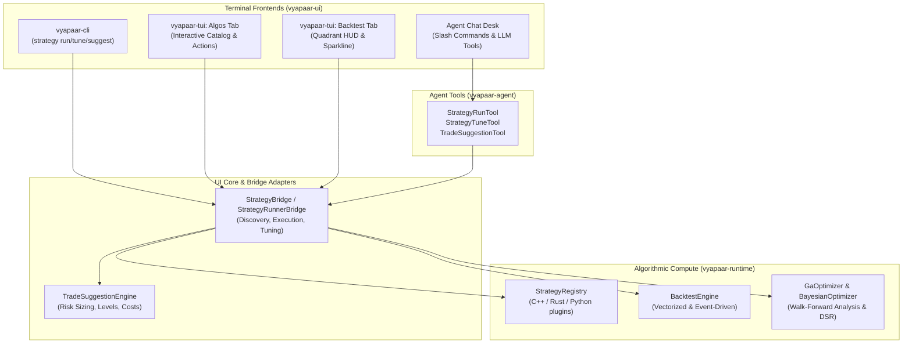

# 0002 — Strategy Execution, Hyperparameter Tuning, and Optimal Trade Suggestion Engine for CLI & TUI

> **Status**: Implemented & Verified (Phases 1–5 Complete)  
> **Target Scope**: `vyapaar-ui` (`vyapaar-cli`, `vyapaar-tui`, `vyapaar-ui-core`, `vyapaar-ui-app`), `vyapaar-runtime` (`vyapaar-runtime-strategy`, `vyapaar-runtime-backtest`, `vyapaar-runtime-enhancer`), `vyapaar-strategies`, `vyapaar-agent` (`vyapaar-agent-chat-tools`)  
> **Reference Inputs**:  
> - `docs/plans/0001-fincept-quantcepts-gap-closure-and-feature-roadmap.md`  
> - `docs/design/architecture.md` (Strategic & Tactical DDD invariants)  
> - `vyapaar-strategies/schema/strategy-manifest.schema.json`  
> - `vyapaar-runtime/crates/vyapaar-runtime-enhancer` (GaOptimizer, BayesianOptimizer, OverfittingGuardrails)  
> - `vyapaar-ui/crates/vyapaar-cli` & `vyapaar-ui/crates/vyapaar-tui`  

---

## 0. Executive Summary & Problem Statement

Vyapaar currently possesses an interactive terminal environment across two primary user interfaces:
1. **Native CLI (`vyapaar-cli`)**: Provides conversational commands (`ask`, `chat`), autonomous jobs (`jobs`), diagnostic checks (`doctor`), and static code safety audits (`verify`).
2. **Workstation TUI (`vyapaar-tui`)**: A 7-tab Ratatui terminal workstation featuring an active Watchlist, an in-process streaming LLM Agent Chat desk, and a comprehensive slash command palette.

However, a critical gap separates the user interfaces from the platform's core algorithmic compute:
- **No Strategy Execution in CLI/TUI**: Neither the CLI nor TUI can discover, load, or execute strategies directly. The `Algos` and `Backtest` tabs in `vyapaar-tui` render static placeholder screens.
- **Disconnected Parameter Tuning**: Advanced hyperparameter search engines in `vyapaar-runtime-enhancer` (Bayesian optimization, Genetic Algorithms, parameter grid sweeps, Walk-Forward Analysis, and Deflated Sharpe Ratio guardrails) are not hooked into the terminal frontends.
- **Missing Actionable Trade Suggestions**: While `vyapaar-agent-chat-tools` contains deterministic calculators for position sizing (`PositionSizingArgs`), statutory costs (`StatutoryCostsArgs`), and return metrics, the system does not combine tuned strategy parameters, recent market data, and risk budgeting to synthesize a concrete, actionable **Optimal Trade Suggestion**.

This specification defines the architecture, data contracts, and implementation roadmap to wire strategy execution and automated parameter tuning into the CLI and TUI, delivering mathematically grounded, risk-budgeted trade suggestions.

---

## 1. End-to-End System Architecture

The following diagram illustrates the interaction between `vyapaar-ui`, `vyapaar-runtime`, `vyapaar-strategies`, and `vyapaar-agent`:



---

## 2. Strategy Catalog & Manifest Discovery

### 2.1 Supported Strategy Classes
The strategy bridge discovers and instantiates strategies across four distinct classes:
1. **Trend Following**: Moving Average Cross (`sma_cross`), Dual EMA, Parabolic SAR, Donchian Channel, Turtle Breakout (`turtle_breakout`).
2. **Mean Reversion**: Bollinger Bands Mean Reversion (`bollinger_reversion`), RSI Oversold/Overbought, Stat-Arb Pairs.
3. **Volatility & Breakout**: ATR Volatility Breakout, Keltner Channel squeeze, Opening Range Breakout (ORB).
4. **Multi-Factor / Quantitative**: Momentum + Value rank, Machine Learning Signal filter.

Each strategy manifests through `strategy-manifest.schema.json` with metadata, parameter schema, supported asset classes, and risk profile.

### 2.2 Unified Strategy Model
```rust
#[derive(Debug, Clone, Serialize, Deserialize)]
pub struct StrategyDescriptor {
    pub id: String,
    pub name: String,
    pub version: String,
    pub description: String,
    pub source: StrategySourceType, // Builtin, PythonPlugin, NativeDylib
    pub parameters: Vec<StrategyParamDescriptor>,
    pub target_instruments: Vec<String>,
}
```

---

## 3. Parameter Tuning & Overfitting Guardrails

### 3.1 Parameter Search Protocols
1. **Grid Search (`TuneMethod::Grid`)**: Exhaustive evaluation across a discretized Cartesian product.
2. **Random Search (`TuneMethod::Random`)**: Quasi-random Sobol sequence sampling.
3. **Genetic Algorithm (`TuneMethod::Genetic`)**: Evolutionary population optimization via `GaOptimizer`.
4. **Bayesian Optimization (`TuneMethod::Bayesian`)**: Gaussian Process surrogate model with Expected Improvement (EI).

### 3.2 Fitness & Statistical Overfitting Guardrails
- **Objective Metrics**: Sharpe Ratio, Sortino Ratio, Calmar Ratio, Profit Factor, Win Rate.
- **Deflated Sharpe Ratio (DSR)**:
  $$\text{DSR} = \Phi\left(\frac{(\widehat{\text{SR}} - \text{SR}^*) \sqrt{N - 1}}{\sqrt{1 - \hat{\gamma}_3 \widehat{\text{SR}} + \frac{\hat{\gamma}_4 - 1}{4}\widehat{\text{SR}}^2}}\right)$$
  Tracks non-normality (skewness $\hat{\gamma}_3$, kurtosis $\hat{\gamma}_4$) and penalizes trials count $N$ to reject data-mined strategies where confidence $< 90\%$.

---

## 4. Optimal Trade Suggestion Formulation

### 4.1 Trade Geometry
Given current market bar $P_t$, ATR indicator $\sigma_{\text{ATR}}$, and strategy bias:
- **Direction**: Long / Short / Neutral
- **Entry Level**: Trigger price $P_{\text{entry}}$
- **Stop Loss**: $P_{\text{entry}} \mp k_{\text{SL}} \cdot \sigma_{\text{ATR}}$
- **Target 1 (1:2 Risk-Reward)**: $P_{\text{entry}} \pm 2 \cdot |P_{\text{entry}} - P_{\text{SL}}|$
- **Target 2 (1:3 Risk-Reward)**: $P_{\text{entry}} \pm 3 \cdot |P_{\text{entry}} - P_{\text{SL}}|$

### 4.2 Risk-Budgeted Position Sizing
Strict 1% account equity risk budgeting:
$$\text{Units} = \left\lfloor \frac{\text{Capital} \times \text{RiskPct}}{|P_{\text{entry}} - P_{\text{SL}}|} \right\rfloor$$

### 4.3 Indian Statutory Transaction Cost Breakdown
Calculates friction accurately with `rust_decimal::Decimal`:
- **STT**: 0.1% on delivery buy/sell, 0.025% on intraday sell.
- **Exchange Turnover**: 0.00345% (NSE).
- **SEBI Charges**: ₹10 per crore (0.0001%).
- **Stamp Duty**: 0.015% on buy.
- **GST**: 18% on (Brokerage + Exchange + SEBI charges).
- **Net RR Calculation**: Net Expected Return after subtracting 2x round-trip transaction costs.

---

## 5. CLI Specification (`vyapaar-cli`)

### 5.1 Command Hierarchy
```bash
vyapaar strategy list
vyapaar strategy run <NAME> --symbol <SYM> [--params <JSON>] [--capital <AMOUNT>] [--format <text|json>]
vyapaar strategy tune <NAME> --symbol <SYM> [--metric <sharpe|sortino|win_rate>] [--method <grid|random|genetic|bayesian>] [--capital <AMOUNT>] [--format <text|json>]
vyapaar strategy suggest <NAME> --symbol <SYM> [--capital <AMOUNT>] [--risk-pct <PCT>] [--format <text|json>]
```

### 5.2 Command Arguments & Flags
```rust
#[derive(Debug, Args)]
pub struct StrategyRunArgs {
    pub name: String,
    #[arg(short, long)]
    pub symbol: String,
    #[arg(short, long)]
    pub params: Option<String>,
    #[arg(short, long, default_value = "1000000")]
    pub capital: Decimal,
    #[arg(short, long, default_value = "text")]
    pub format: OutputFormat,
}

#[derive(Debug, Args)]
pub struct StrategyTuneArgs {
    pub name: String,
    #[arg(short, long)]
    pub symbol: String,
    #[arg(short, long, default_value = "sharpe")]
    pub metric: String,
    #[arg(short, long, default_value = "grid")]
    pub method: String,
    #[arg(short, long, default_value = "1000000")]
    pub capital: Decimal,
    #[arg(short, long, default_value = "text")]
    pub format: OutputFormat,
}

#[derive(Debug, Args)]
pub struct StrategySuggestArgs {
    pub name: String,
    #[arg(short, long)]
    pub symbol: String,
    #[arg(short, long, default_value = "1000000")]
    pub capital: Decimal,
    #[arg(short, long, default_value = "0.01")]
    pub risk_pct: Decimal,
    #[arg(short, long, default_value = "text")]
    pub format: OutputFormat,
}
```

### 5.3 CLI Output Example
```
┌────────────────────────────────────────────────────────────────────────┐
│ Strategy Parameter Tuning & Overfitting Audit: turtle_breakout         │
│ Target: NSE:NIFTY50-INDEX    | Evaluated Trials: 100                   │
├────────────────────────────────────────────────────────────────────────┤
│ Parameter           Default Value   Tuned Value     Status             │
│ ──────────────────  ──────────────  ──────────────  ────────────────── │
│ entry_period        20              9               search range       │
│ exit_period         10              6               search range       │
│ instrument          10              10              search range       │
│ quantity            10              1               search range       │
├────────────────────────────────────────────────────────────────────────┤
│ Baseline Sharpe:   1.10            Optimal Sharpe:  1.44               │
│ Max Drawdown:      0.15%           Win Rate:        90.00%             │
│ Deflated Sharpe:   79.12% confidence (DSR >= 90% target)               │
│ Verdict:           Moderate Overfitting Risk (Borderline Significance) │
└────────────────────────────────────────────────────────────────────────┘
```

---

## 6. TUI Specification (`vyapaar-tui`)

### 6.1 Algos Tab (`ActiveTab::Algos`)
- **Left Panel (60%)**: Strategy Manifest Table listing Name, Version, Status (Active, Paused, Stopped), Sharpe, and Supported Instruments.
- **Right Panel (40%)**: Parameter Inspector displaying parameter schema, types, bounds, and search domains.
- **Interactive Action Bar**:
  - `[Space]` Toggle Status (Active / Paused / Stopped)
  - `[Enter]` Run Backtest with current configuration
  - `[T]` Tune Strategy Hyperparameters
  - `[S]` Generate Optimal Trade Suggestion

### 6.2 Backtest Tab (`ActiveTab::Backtest`)
4-Quadrant HUD Workstation:
- **Top-Left (KPI Cards)**: Total PnL, Win Rate, Sharpe Ratio, Max Drawdown.
- **Top-Right (Parameter Delta Table)**: Baseline vs Tuned parameters with search bounds.
- **Bottom-Left (Ratatui Sparkline Curve)**: Historical equity curve with cumulative performance.
- **Bottom-Right (Optimal Trade Execution Card)**: Entry, Stop Loss, Targets 1 & 2, Risk Budget, and Statutory Cost breakdown.

### 6.3 Command Palette Slash Commands
- `/algos` — Switch to Algos catalog tab.
- `/backtest [strategy]` — Switch to Backtest workstation and run backtest.
- `/tune [strategy]` — Launch hyperparameter optimization audit.
- `/suggest [strategy]` — Compute optimal trade recommendation card.

### 6.4 Conversational Agent Desk Integration
`vyapaar-agent-chat-tools` exposes strategy runner and suggestion capabilities as read-only advisory tools:
- `StrategyRunTool` (`strategy_run`): Executes backtests on demand from conversational prompts.
- `StrategyTuneTool` (`strategy_tune`): Runs parameter search and overfitting audit.
- `TradeSuggestionTool` (`trade_suggest`): Synthesizes geometry, sizing, and cost breakdown.

---

## 7. Implementation Phasing & Conformance Matrix

| Phase | Target Module | Scope of Work | Status |
| :--- | :--- | :--- | :--- |
| **Phase 1** | `vyapaar-ui-core` / Bridge | Build `StrategyCatalog`, `StrategyBridge`, parameter sweep adapter, and `TradeSuggestionEngine` | **Done** |
| **Phase 2** | `vyapaar-cli` | Implement `StrategyCommand` in `args.rs` and execution handlers in `runner.rs` with text and JSON formatters | **Done** |
| **Phase 3** | `vyapaar-tui` | Implement `draw_algos` and `draw_backtest` in `ui.rs`, connect `AlgosFeature` and `BacktestFeature` in `app.rs`, add hotkeys & slash commands | **Done** |
| **Phase 4** | `vyapaar-agent-chat-tools` | Expose `StrategyRunTool`, `StrategyTuneTool`, `TradeSuggestionTool` domain port & tools; wire into CLI `ask`/`chat` & TUI `AgentChat` | **Done** |
| **Phase 5** | Verification & Tests | Unit tests for parameter sweep accuracy, DSR calculation, risk sizing math, and CLI/TUI integration tests (35 CLI tests, 21 TUI tests, 10 agent chat tools tests) | **Done** |

### Architectural Invariants
1. **Zero Floats Rule**: All prices, capital, risk percentages, and statutory fees strictly use `rust_decimal::Decimal`.
2. **NoFX Advisory Principle**: Trade suggestions are purely advisory recommendations; live order execution requires explicit user authorization.
3. **WASM Safety**: `vyapaar-ui-core` and presentation modules remain free from `tokio`, threads, and blocking I/O (guarded with `#[cfg(not(target_arch = "wasm32"))]`).
